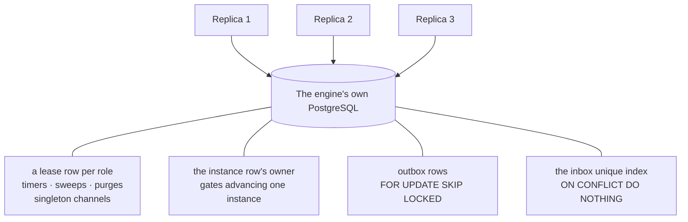
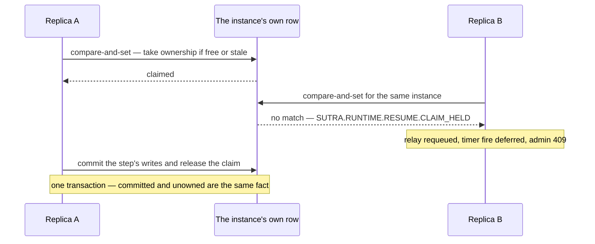
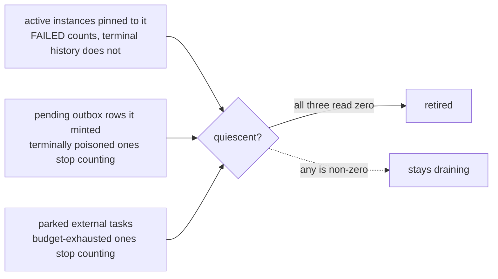

# Replica semantics

Sutra runs as an **active-active stateless replica set** — all durable state lives in PostgreSQL,
and no replica owns any particular instance, tenant, or channel by default. Any replica can pick up
any token at any time, which is what lets the engine scale horizontally with no sticky routing.

## What every replica does

Each replica is one engine process running inbound channel listeners (the HTTP server, broker
consumers), the token executor for instances it picks up from persistence, an outbox worker
sending replies it claims, and the health/metrics endpoints. Execution inside the process runs on
one or more identical actor lanes — see [Execution lanes](execution-lanes.md); lanes are an
in-process concern and change nothing on this page. Three pieces of work don't tolerate
concurrency and are held by exactly one replica at a time instead: **timer firing**,
**stuck-instance scanning**, and **terminal-history purging**.

Every replica is identical and interchangeable; each of the four things that must not happen twice
is a different row-level primitive in the one shared database, not a coordination service.

## Leader election: a PostgreSQL-backed lease

There is no Kubernetes-native `Lease` object and no separate coordination service — leader
election is a lease row in the engine's own PostgreSQL database (`DbLeaderElection` over
`PgLeaseStore`). One poll task per **role** tries to acquire the lease at a fixed cadence
(`ttl = 30s`, `poll = 10s`); a successful acquire flips that replica to leader for that role, a
contended one flips it to follower. There's no push notification — polling *is* the mechanism.

Roles are dynamic, not a fixed pair: the engine registers one lease per **singleton channel
role** (`channel_role(tenant, channel)`) the first time it's needed, so declaring a channel
`singleton: true` (see [Channels and transports](../building/channels.md) and the
[money-transfer example](../building/worked-example.md)) starts contending a lease without any
separate configuration. When no engine datasource is configured at all, every replica simply
leads unconditionally (`AlwaysLeading`) — there's no third posture to reason about.

## Instance ownership claims

Leases gate *roles*. What keeps two replicas from advancing the **same instance** at the same
moment is a different, finer mechanism: a per-instance ownership claim, taken by a
compare-and-set on the instance's own row.

**Every resume path claims first.** A correlated relay arriving on a channel, a timer firing, an
administrative migration — each one takes the claim before it rehydrates anything, and a claim it
cannot take is a refusal, never a wait. The refusal is retry-safe by design and carries a
structured code (`SUTRA.RUNTIME.RESUME.CLAIM_HELD`, or the admin surface's
`SUTRA.ADMIN.MIGRATE.CLAIM_HELD`): a broker relay is requeued for redelivery, a timer fire is
deferred to a later tick, an admin call answers `409` having read and written nothing. Nothing is
ever half-applied while contended, and nothing blocks waiting for a lock held on another
replica's timescale.

The claim is released inside the same transaction that commits the step's own writes, so
"committed" and "unowned again" are one atomic fact. Every exit that does *not* commit — an early
refusal, an error, a panic — releases the claim explicitly on its way out, so a claim never
outlives the work it was protecting.

The whole mechanism is two round trips against one row: the loser of the race has read and written
nothing, and the winner never holds the claim past the commit it was protecting.

**The claim is re-entrant for the same owner**, and the invariant that makes that safe is worth
stating exactly: an owner id names one *execution lane* in one process, and a lane advances
instances one at a time. Same owner therefore means same lane, which already means serialized —
so re-claiming what you already hold is a heartbeat refresh rather than contention. Owner ids
carry the lane index for exactly this reason, and the administrative migration path takes a
deliberately *distinct* owner suffix so that a migration can never re-enter past a resume this
same replica has in flight.

**The stuck-instance sweep** is the backstop for the case no protocol can prevent — a replica
that dies mid-step and never releases. The `instance-sweeper` lease role scans on
`sutra.instance.sweep-interval` (default `PT1M`) and clears any claim whose owner has been silent
longer than `sutra.instance.claim-timeout` (default `PT5M`). It sweeps by age and is
owner-blind, so it needs to know nothing about how owner ids are shaped.

## Durable `FAILED` is a state, not a disappearance {#durable-failed-is-a-state-not-a-disappearance}

An instance whose execution fails fatally is not deleted and does not silently linger as a
mystery park. Its snapshot is re-stamped **`FAILED`** in place, carrying the structured failure
code and the captured detail, and every waiting row it held is resolved in the same transaction —
so no timer refires against it and no relay finds a live wait to satisfy.

`FAILED` is deliberately **not** terminal:

- it is always retained, regardless of the history-retention window, because it needs an operator
  rather than a clock;
- it keeps blocking its deployment's retirement (below), so a dead-but-unhandled instance cannot
  be quietly swept under a hot-deploy;
- it is the one state an instance can be [migrated](../operating/instance-migration.md) *and*
  resumed out of — repair the model, move the instance onto it, then explicitly bring it back.

Restoring it is exactly the inverse of the failure commit: the failure keys are dropped, the
status goes back to suspended, and the parks the failure tore down are re-armed — after which the
instance comes back through the ordinary claim-guarded paths. There is no privileged resume entry
point.

## Inbox dedup via row locks

An inbound message's `(tenant, channel, event_id)` triple is inserted with `ON CONFLICT DO
NOTHING`; whichever replica's insert actually produced a row owns starting that instance, and any
other replica that raced it (or a genuine redelivery) sees nothing came back and treats it as a
dedup hit. This is a plain unique-index conflict — no application-level locking, and it works
identically whichever replica happens to receive the redelivered copy.

## Outbox processing: `SKIP LOCKED` and a claim lease {#outbox-processing-skip-locked-and-a-claim-lease}

Every reply-in-waiting sits in an outbox table. Each replica's outbox dispatcher claims a batch with
`FOR UPDATE SKIP LOCKED`, so replicas never contend on the same row. Those row locks end when the
claim's transaction commits, which is before the rows are delivered. So the same statement also
**leases** each claimed row: it moves the row's due time 30 seconds ahead. No claim on any replica
returns the row before then. While the row waits for a delivery worker or is being delivered, the
claiming replica renews the lease every 10 seconds. A successful delivery deletes the row, and a
failed one replaces the lease with its retry backoff. Under normal operation no row is sent twice,
however many replicas share the database.

A replica that dies holding rows stops renewing their leases. Within 30 seconds the leases lapse,
and the next replica to claim delivers the rows. The rare case where the original send went out
just before the crash is absorbed downstream: the outbox row's key travels as the message's own
idempotency token.

The renewal never waits for a row lock. It skips a row another transaction holds, because the
only holders of an in-flight row are the transactions that end its lease on purpose (the delete of
a delivered row, a retry's backoff, a poison) or another replica's claim of a lease that has
already lapsed. It renews at most 1024 rows per transaction, leaves out rows already delivered and
waiting for their delete, and has a database connection of its own. A renewal round slower than
5 seconds is logged at `warn`.

> **Fixed in 0.6.12.** From 0.6.8 to 0.6.11 the renewal was one statement over every in-flight row,
> and it locked rows that the batch delete of delivered rows was locking too, each in its own
> order. Under a burst of deliveries PostgreSQL aborted one of them with `deadlock detected`: a lost
> delete was retried row by row (`outbox delete failed: deadlock detected`, nothing lost), a lost
> renewal renewed nothing that round. When the engine fell behind, the renewal took 1 to 3
> seconds.

> **Fixed in 0.6.8.** Releases 0.6.5 to 0.6.7 took the row locks but wrote no lease. A second
> replica's claim could pick up a row the first was still delivering, and under multi-replica load
> about half of all outbound messages were sent twice. Nothing was lost and every instance still
> completed once. A single engine was not affected.

## Retiring a draining deployment: a three-legged gate {#retiring-a-draining-deployment-a-three-legged-gate}

A hot-deploy leaves the previous graph **draining** rather than deleting it, precisely so
instances pinned to it keep resuming on the definition they started under. It retires only when
it is genuinely quiescent — and "quiescent" is three independent facts, all of which must hold:

1. **No active instances** pinned to it. Retained terminal history does not count (it would
   otherwise pin a deployment open for a whole retention window); `FAILED` instances *do* count,
   because they are live work awaiting an operator.
2. **No pending outbox rows** minted by it. An emission belongs to the channel bindings that
   produced it, so it drains where it was made. A delivery that exhausted an opt-in attempt
   ceiling is marked terminally poisoned and stops counting — "we gave up" is a durable, visible
   state, and it must not hold a deployment open forever.
3. **No parked external tasks** waiting on it. A task parked for a pull worker is outstanding work
   with no in-flight anything to observe; retiring underneath it would strand the worker's
   completion. Tasks that turned terminal after exhausting their worker budget stop counting, for
   the same reason poisoned deliveries do.

All three legs are database-scoped counts, so the gate reads the same from every replica and is
unaffected by which replica happens to run the sweep.

## Recovery on pod death

Because token state lives in the database, a dead replica leaves nothing to recover from memory:

- **Mid-token-execution** — the instance's claim goes stale with its owner; the stuck-instance
  sweep clears it and the next replica to see ready work picks the instance up.
- **Mid inbox-to-instance handoff** — an inbox row without a matching instance past a recovery
  threshold gets retried; the same unique-index dedup makes the retry safe.
- **Mid outbox send** — the dead replica's claim lease lapses within 30 seconds and the row is
  delivered by whichever replica claims it next.
- **The leader itself dies** — its lease expires within its TTL and another replica's next poll
  acquires it; timer scheduling pauses for at most that window, while outbox processing continues
  uninterrupted on every other replica throughout.

## Scaling signal

CPU is not a meaningful autoscaling signal for an event-driven engine — the right one is backlog
depth (inbox rows waiting to start an instance, outbox rows waiting to send), which is what a
KEDA `ScaledObject` querying the engine's own tables drives off. See the OpenTofu module under
`deploy/modules/sutra/` for the shipped shape.

## Non-goals

No active-passive mode (every replica processes real work; the lease only gates the singleton
pieces), no sticky session routing, no tenant-to-replica affinity (isolation is a PostgreSQL RLS
concern — see [Multi-tenancy and isolation](multi-tenancy.md) — not a placement one), and no
engine-managed broker resources (queues/topics are provisioned by your own infrastructure
tooling; the engine connects to what already exists).

## Next

- **[Execution lanes](execution-lanes.md)** — the in-process half: N actor lanes under one
  replica, and why claims rather than routing keep them correct.
- **[Multi-tenancy and isolation](multi-tenancy.md)** — the other half of "many tenants, one
  engine, one database."
- **[Deployment model](deployment-model.md)** — how the same PostgreSQL-backed convergence pattern
  (`LISTEN`/`NOTIFY`, version polling) applies to deploy activation across a fleet.
- **[Ownership and claims: the design reasoning](../internals/ownership-and-claims.md)** — the
  compare-and-set, the re-entrancy invariant, and the owner-suffix conventions.
