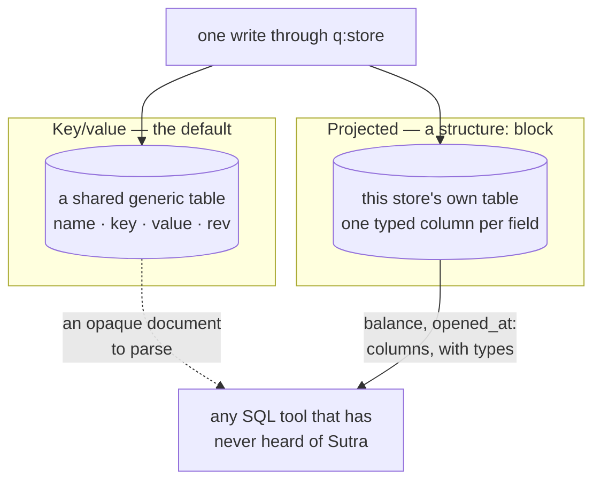
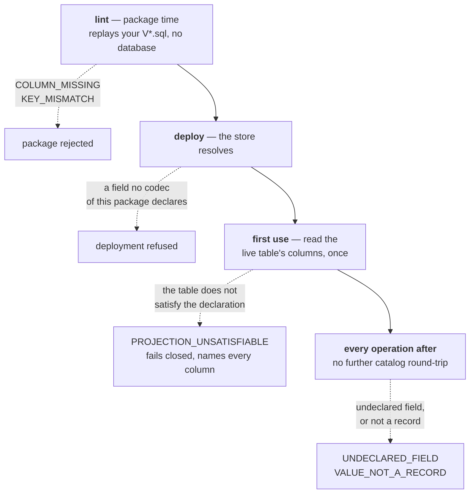

# Data stores

A **data object** (`<bpmn:dataObject>`) is a per-instance variable — private, transient, born and
dying with one instance. A **data store** (`<bpmn:dataStore>` / `<bpmn:dataStoreReference>`) is the
opposite axis: durable, keyed state that **outlives and is shared across** instances — an account
ledger, a customer index, the covered/uncovered flags behind a compliance route.

> **Status note.** Data stores are exercised end to end by the
> [money-transfer example](worked-example.md) — a real `sql`-backed ledger under transactional,
> pessimistic-lock control. (Path coverage rides a data store of an unusual kind: its marks *are*
> persisted in a store the package declares — the reserved `coverage` name, whose connection picks
> the database they land in — but the engine owns that store's *schema* and applies it itself, so it
> is neither a key→value business store nor one you write DDL for. See
> [Coverage: declared routes as the compliance signal](coverage.md#where-coverage-is-stored).)
> Some of the wider surface described in the design record — a `file`-backed store, an
> optimistic-concurrency compare-and-set on every provider — is still in motion; treat anything
> below not shown against the money-transfer example as directionally accurate rather than a
> finished contract, and check `rust/crates/sutra-datastore` for the current provider set before
> depending on specifics.

## Choosing a store shape

A business store has two shapes. The choice between them is narrower than the volume of mechanism
the rest of this chapter spends on the second one suggests, so it is worth settling first. (The
reserved `coverage` store is neither — the engine owns its schema and applies it, so a package
writes no coverage DDL and makes no shape choice at all; see
[Coverage](coverage.md#where-coverage-is-stored).)

**Key/value is the general case, and it is always sufficient.** By default a store is a key→value
store: one row per key, the value serialized whole as JSON text. Any structure fits it — nested,
repeated, open-ended, a different shape next release — because nothing about the value's shape is
written down anywhere for it to disagree with. The table behind it is one fixed generic shape
(store name, key, value, `rev`, `updated_at`) shared by every key/value store on that connection,
and it does not change when your data does. From a standards point of view this is the only shape
that carries *every* scenario, which is why it is the default and stays the default. A store with
no `structure:` block is this store, and none of the projection machinery below applies to it.

**Projection is an integration affordance, not an upgrade.** Declaring a `structure:` does not make
a store more correct, more durable or more capable, and it is not a tier you graduate to. It exists
for one reason: so that everything *else* that already speaks SQL can read the data. A BI tool, a
dashboard, a nightly reporting query, an analyst with read access to that database — none of them
know what Sutra is, and against a key/value store the most any of them can see is an opaque
document to parse. Against a projected table they see `balance` and `opened_at` as columns, with
types. That is one more way to ease integration, not a better kind of store.

**The trade, stated plainly.** Projection costs two things and buys one:

- It costs the **flat-only constraint**. The declared type must be entirely scalar, and a type that
  later grows a nested or repeated child stops projecting at all — see [Flat only](#flat-only).
- It costs **ownership of the DDL and its evolution**. You write the `CREATE TABLE`, and every
  change to the declared type is a migration you author and sequence. A key/value store needs a
  table too, but it is the same generic one every time — written once, never revisited. A projected
  table is your record's own shape, so it has to move whenever that shape moves.
- It buys **direct SQL access** to the data, for anything that speaks SQL, without going through
  the engine.

If nothing outside the process ever reads the store, that affordance buys nothing, and key/value is
the right answer.



Both shapes hold the same record and answer the same `<q:store>` access with the same locking and
`rev` semantics; the only thing projection moves is the arrow on the right — an opaque document
versus columns a reader can use directly, bought with the flat-only constraint and ownership of the
DDL.

**The shape is a property of the store, not of the flow — within limits worth knowing.** A store's
shape is declared in `datastores.yaml` and nowhere else. The BPMN is unchanged either way: the same
`<bpmn:dataStoreReference>`, the same `<q:store>` with the same `key` / `field` / `forUpdate` /
`expect` attributes, resolved by store *name* through the same registry. Pessimistic locking,
`<bpmn:transaction>` enlistment and rollback, `delete`, and the `rev` bookkeeping behind
`expect="unchanged"` — seeded at 1, bumped on every write, a conflict when the revision moved —
carry the same semantics under both shapes. Adding or removing a `structure:` block is a
package-level change, not a process-level one.

What does change is what the store **accepts** and what it **hands back** — and that is not nothing:

- A projected store **refuses a write carrying a field the structure does not declare**
  (`UNDECLARED_FIELD`); a key/value store simply stores it. This is the difference most likely to
  bite, because a process that has quietly been writing a wider record than the declared type works
  against key/value and fails against projection — and nothing catches it beforehand: neither
  `sutra lint` nor the executor checks a `<q:store field="…">` name against the declared structure,
  so the first evidence is the refused write.
- It **refuses a value that isn't a record at all** — a scalar, an array, an explicit `null`
  (`VALUE_NOT_A_RECORD`). A key/value store holds any of those happily.
- It **refuses every operation until the live table satisfies the declaration**
  (`PROJECTION_UNSATISFIABLE`, checked on first use). A key/value store has no declaration to drift
  from, so it has no such failure mode.
- A `field`-narrowed write is a read-modify-write of the whole value under both shapes, so one that
  *creates* a key writes a record containing only that field. On a key/value store that is simply a
  one-field document; on a projected store every *other* declared column is bound `NULL`, so unless
  they are all nullable or defaulted in your DDL that insert runs straight into your own
  constraints. Make the first write of a key a full record rather than a narrowed one.
- Values that pass through a typed column come back in the **column's** canonical form rather than
  the text that was written: an explicit `null` and an absent optional field become the same thing
  on read, and a `dateTime` comes back as your dialect's rendering of that instant. The exact scope
  of what is and isn't preserved is in [A worked example](#a-worked-example).

None of those change how a process *addresses* the store; several of them change whether a given
write succeeds. They are the checklist for a shape change, not a reason to avoid one.

**Column names become a published interface.** The moment a dashboard reads that table, its column
names are a contract with someone who has never seen your schema — a report knows `account_balance`,
not the XSD element it was derived from. Column names are derived by convention from the declared
field names, so renaming a field renames a column, and silently breaks that report. That is what
the `columns:` override exists for: pin the physical name, and the schema can be renamed underneath
it while the published surface holds still. It is worth setting before you need it rather than
after someone's query starts returning nothing — the naming rules and the override syntax are under
[Column names](#column-names).

## Declaring a store

One flat `datastores.yaml` per package (see [Deployment packages](deployment-packages.md)). The
module **owns its store** — the connection is declared here, resolved from environment references,
and its migrations ship inside the package:

```yaml
# examples/money-transfer/.../datastores.yaml (abridged)
datastores:
  - name: accounts
    type: sql
    sql:
      url-ref: env:ACCOUNTS_DB_URL
      username-ref: env:ACCOUNTS_DB_USER
      password-ref: env:ACCOUNTS_DB_PASSWORD
      migrations: migrations/accounts     # idempotent SQL, run once on first use
    dataClass: financial                  # sensitivity tag — redacted in audit/logs/traces
```

A store's migrations run the first time the store is used, under a database lock, so replicas
never run them at the same moment. The lock is one per database (per server on MySQL and MariaDB),
not one per store, because several stores often share one table and the same `CREATE TABLE IF NOT
EXISTS`. Before 0.6.12 the lock was per store, and two stores sharing a table that were first used
at the same moment could fail that first request with HTTP 500
(`pg_type_typname_nsp_index`); the next request succeeded.

The engine's own datasource (instances, outbox, lease, audit, inbox) is **never** a store's
backing connection — a `sql` store always resolves its own connection, and fails closed if it
declares none. This is what makes a generic engine image self-sufficient against any number of
modules that each bring their own store: no baked default datasource, no baked migrations.

A store declared this way is the **key/value** shape: one row per key, the value serialized whole
as JSON text, opaque to the database. Adding a `structure:` block projects a flat record onto real
typed columns instead — see
[Typed columns: declaring the structure a store holds](#typed-columns-declaring-the-structure-a-store-holds)
below.

## Referencing a store from BPMN

```xml
<bpmn:dataStore id="accountsStore" name="accounts"/>   <!-- definitions scope -->

<bpmn:dataStoreReference id="dsrFrom" name="accounts" dataStoreRef="accountsStore">
  <bpmn:extensionElements>
    <q:store key="payload.fromId" forUpdate="true"/>
  </bpmn:extensionElements>
</bpmn:dataStoreReference>
```

`<q:store>` (see [The q: namespace](q-namespace.md)) is what turns a bare reference into a keyed
access: `key` is a FEEL expression producing the row key, `forUpdate="true"` takes a pessimistic
row lock so concurrent writers on the same key serialize, `field` narrows a write to one field of a
stored map value, and `expect="unchanged"` is an optimistic compare-and-set alternative to a lock.
`expect="absent"` and `query` are covered in [Claiming a key once](#claiming-a-key-once) and
[Querying rows by key](#querying-rows-by-key).
A data task — a `serviceTask` with no `implementation` — reads and writes through its data
associations exactly like it would a data object, except the source/target is a store reference
instead of a variable.

## Typed columns: declaring the structure a store holds {#typed-columns-declaring-the-structure-a-store-holds}

An opaque store hands the database a string. Nothing inside the value is queryable, indexable or
typed, and the only way to read a field is to fetch the whole document by key and pick it apart in
the process. For a record whose fields are all scalars that is a blob tax on data that could
perfectly well be ordinary columns.

So a store may **declare the structure it stores**, not just its key:

```yaml
datastores:
  - name: accounts
    type: sql
    structure:
      schema: urn:accounts        # a schemas/<folder> codec of this package
      type: AccountRecord         # a complexType, a root element, or a JSON Schema definition
    sql:
      url-ref: env:ACCOUNTS_DB_URL
      migrations: migrations/accounts
```

`schema` + `type` resolve through the schemas the package **already** compiles for its codecs (the
path-derived URN rule is in [Deployment packages](deployment-packages.md#referencing-resources--convention-over-configuration)),
so there is no second schema source to keep in step and no shape inferred from observed data — the
declaration is the contract.

> **A store with no `structure:` block behaves exactly as it always did.** Same opaque key→JSON
> row, same providers, same `<q:store>` semantics, and none of the diagnostics below ever fire for
> it. Declaring a structure is opt-in per store; a record too nested to project simply doesn't
> declare one.

### Flat only

The declared type must be **entirely scalar**. Every child is classified in declared order:

| Declared shape | Becomes |
|---|---|
| Scalar leaf, at most once (a simple-type element or an attribute) | a column |
| Scalar leaf, `minOccurs="0"` | a nullable column |
| Scalar element inside a `choice` | a nullable column (at most one branch is populated) |
| A complex child — a nested object | **lint error** |
| Anything that may occur more than once | **lint error** |
| Open content (`xs:any`, JSON Schema `additionalProperties: true`) | **lint error** |

**The table *is* the declared fields.** There is no residue column for the parts that didn't fit,
no column-versus-JSON merge on read, and no partial projection. That is the whole simplification,
and it is what makes a projected row readable by anything that speaks SQL without knowing Sutra
exists.

A type that can't be expressed that way is rejected at package time with
`SUTRA.CONFIG.DATASTORE.STRUCTURE_NOT_FLAT`, naming the offending child:

```text
data store 'accounts': declared structure type 'AccountRecord' is not flat: 'owner' is not a
scalar leaf (nested content). Flatten the type, or remove the 'structure' block and keep the
opaque store.
```

Those two remedies are the whole menu, deliberately:

- **Flatten the type** — pull the nested part up into scalar siblings (`owner/name` → `ownerName`),
  or move it to a store of its own keyed by the same business id.
- **Drop the `structure:` block** — the store goes back to being the opaque key→JSON store it was,
  which is a perfectly good answer for a record that genuinely isn't flat.

There is nothing in between, because anything in between would be a silent partial projection —
some fields queryable, some hidden in a blob, and a merge rule nobody can see from the declaration.

Because the structure is closed and there is nowhere for an unexpected field to go, a write
carrying a field the structure does not declare is a **fail-closed runtime error**
(`SUTRA.RUNTIME.DATASTORE.UNDECLARED_FIELD`) naming the field. Silently dropping it is the one
outcome this design refuses. Writing anything that isn't a record at all — a scalar, an array, an
explicit `null` for the whole value — is refused the same way, as
`SUTRA.RUNTIME.DATASTORE.VALUE_NOT_A_RECORD`: a projected row *is* its declared fields, so there is
nowhere for a bare value to land either.

### Control columns {#control-columns}

A projected table is never *only* the declared fields. Three columns belong to the engine, on
every projected table, whether or not your own type ever mentions them:

| Column | Role |
|---|---|
| `store_key` | the store key — whatever the store's `<q:store key="…">` expression produces — and the table's `PRIMARY KEY` |
| `rev` | the optimistic-concurrency revision, bumped on every write; what `put_if_revision` keys on |
| `updated_at` | the write timestamp |

There is no `store_name` column — a projected table *is* one store, unlike the opaque table that
multiplexes many stores by name. The runtime binds and maintains all three itself, so a declared
field may not claim one of their names: that's a naming collision
(`SUTRA.CONFIG.DATASTORE.COLUMN_NAME_INVALID`), resolved the same way as any other one — map the
field to a different column under `columns:`. Your own migration has to create all three alongside
your declared columns, or `sutra lint` raises `COLUMN_MISSING` naming whichever is absent — a
projected table missing `store_key`, `rev` or `updated_at` cannot be served no matter how correct
its declared columns are. The worked example below shows all three in the DDL.

### Column names

A declared field's column name is derived by convention: `lowerCamel` → `snake_case`, ASCII-folded,
runs of anything else collapsed to a single `_`.

| Declared field | Column |
|---|---|
| `accountId` | `account_id` |
| `openedAt` | `opened_at` |
| `iso4217Code` | `iso4217_code` |
| `IBANCode` | `iban_code` |

The convention is not always enough, and when it isn't, `sutra lint` says so
(`SUTRA.CONFIG.DATASTORE.COLUMN_NAME_INVALID`) rather than guessing: two fields folding to the
same column, a fold that lands on a SQL reserved word, a name over the 63-character identifier cap
(PostgreSQL's — the narrowest of the three shipped dialects, so a name that clears it is portable),
or a fold that isn't a usable identifier at all. Every one of them is resolved by naming the column
yourself:

```yaml
    structure:
      schema: urn:accounts
      type: AccountRecord
      columns:
        openedAt: opened_on       # the DDL already calls it this
        order:    order_seq       # `order` is reserved
```

The mapping exists for two reasons. The first is that **you** write the DDL and may already have
column names you can't change. The second is that it **pins the physical name against a later
schema rename** — which matters as soon as anything outside the engine reads the table, because at
that point the column names are a published interface and the convention is no longer yours alone
to change (see [Choosing a store shape](#choosing-a-store-shape)). The mapping is checked by the
same rules — an override that is itself reserved or over-length is still an error, and an override
naming a field the type doesn't declare is an error rather than a silent no-op.

### You own the DDL; the engine verifies it

The engine generates no DDL for a projected store and owns no part of its table shape. That table
is created by the store's own migrations, in your own dialect, shipped inside the
package under
`migrations/<store>/` (see [Deployment packages](deployment-packages.md#store-migrations-and-schema-evolution)).

`sutra lint` derives the **effective** table shape statically — from the package's own
`migrations/<store>/V*.sql`, replayed in version order (`CREATE TABLE` plus
`ALTER TABLE ADD/ALTER/DROP COLUMN`), with **no database connection and no credentials** — and
compares it against the projection. The table it compares against is the one named after the store
— or, if the migrations create exactly one table, that one — or the one you name explicitly:

```yaml
    sql:
      url-ref: env:ACCOUNTS_DB_URL
      migrations: migrations/accounts
      table: account_ledger       # when the table isn't named after the store
```

What it checks the column types against is this mapping. It is advisory — the shape lint expects to
find, not DDL anything emits:

| Declared | PostgreSQL | MySQL / MariaDB | SQL Server |
|---|---|---|---|
| `xs:string` + `maxLength n` | `VARCHAR(n)` | `VARCHAR(n)` | `NVARCHAR(n)` |
| `xs:string`, unbounded | `TEXT` | `LONGTEXT` | `NVARCHAR(MAX)` |
| `xs:decimal` + `totalDigits p` / `fractionDigits s` | `NUMERIC(p,s)` | `DECIMAL(p,s)` | `DECIMAL(p,s)` |
| `xs:int` / `xs:long` / `xs:short` | `INTEGER` / `BIGINT` / `SMALLINT` | same | `INT` / `BIGINT` / `SMALLINT` |
| `xs:boolean` | `BOOLEAN` | `TINYINT(1)` | `BIT` |
| `xs:date` / `xs:dateTime` / `xs:time` | `DATE` / `TIMESTAMPTZ` / `TIME` | `DATE` / `DATETIME` / `TIME` | `DATE` / `DATETIME2` / `TIME` |
| `xs:base64Binary` | `BYTEA` | `BLOB` | `VARBINARY(MAX)` |
| an `enumeration` facet | the base type (a `CHECK` or a lookup table is your choice) | same | same |

Two declared shapes this release refuses outright — not silently degraded, not weakly verified —
and one honest limit on verification alone:

- **`xs:base64Binary` is refused, not projected.** The advisory mapping above (`BYTEA` / `BLOB` /
  `VARBINARY(MAX)`) is what the *column* would need to be; the runtime doesn't marshal binary
  values through a projected column yet. A store declaring one is refused when the engine resolves
  it — at deploy time, not at lint time — naming the field:

  ```text
  data store 'accounts' cannot project structure type 'AccountRecord': field 'attachment' is
  declared 'base64Binary', which a projected column does not carry in this release — declare it
  as a string, or remove the 'structure' block and keep the opaque store.
  ```

  Lint doesn't catch this on its own: its DDL parser treats `BYTEA`/`BLOB`/`VARBINARY` as an
  ordinary column type and matches it happily, so a package can lint clean and still refuse to
  deploy. Don't read lint's silence as proof a binary field works.
- **A JSON-Schema-declared structure is refused, not weakly verified.** Only a package
  `schemas/<folder>` XSD codec carries the enumerable, facet-bearing field list a typed column is
  checked against — a JSON Schema definition has no such list at this phase. `sutra lint` reports
  that honestly as a `DDL_UNVERIFIABLE` warning (unprovable, not necessarily wrong) — but the
  engine that actually resolves the store at deploy time draws a harder line and refuses to load
  the deployment:

  ```text
  data store 'accounts' declares structure schema 'urn:accounts', which this package provides no
  XSD codec for. A projected store's type must be declared by a schemas/<folder> XSD codec of the
  same package — only XSD carries the declared facets a typed column is checked against.
  ```

  So a lint-clean package with a JSON-Schema `structure:` still will not deploy. Declare the
  structure against an XSD if you want the store to exist at all, not just to have its column
  types checked.
- **DDL outside the parsed subset degrades to a warning, never to a false error.** A migration that
  creates the table in a PL/pgSQL block, a T-SQL procedural guard, a table created outside the
  package entirely — lint reports that it could not derive the shape and raises no column
  diagnostic for that store. A linter that cries wolf on legitimate DDL is worse than no linter,
  because authors learn to ignore it. See
  [Troubleshooting](../operating/troubleshooting.md#data-store-diagnostics-projected-stores) for
  how to read that warning.

Lint proves the package-time case. The deployed table is checked separately, but not on every
operation: first use of a projected store rides the *same* once-per-store-instance gate that runs
its migrations (the one already serialized across replicas by an advisory lock), and there the
provider reads the live table's actual columns and **fails the store closed** if the projection
isn't satisfiable, naming every offending column at once. That is the defence against a table that
drifted from the package's own migrations — a hand-applied `ALTER` — and it fails loudly because a
silent partial write is far worse than a refusal. It costs one catalog round-trip the first time
the store is used, and nothing on any operation after that.



Each gate sees something the one before it could not — lint has the migrations but no database,
deploy has the resolved store but no table, first use has the live catalog — which is why a package
can pass lint (or draw only a warning from it) and still refuse to deploy.

### A worked example

A flat record, declared in the package's own codec schema
(`schemas/accounts/accounts.xsd`, the codec `urn:accounts`):

```xml
<xs:element name="AccountRecord">
  <xs:complexType>
    <xs:sequence>
      <xs:element name="accountId" type="AccountId"/>
      <xs:element name="balance"   type="Money"/>
      <xs:element name="openedAt"  type="xs:date"/>
      <xs:element name="active"    type="xs:boolean"/>
      <xs:element name="note"      type="Note" minOccurs="0"/>
    </xs:sequence>
  </xs:complexType>
</xs:element>

<xs:simpleType name="AccountId">
  <xs:restriction base="xs:string"><xs:maxLength value="35"/></xs:restriction>
</xs:simpleType>
<xs:simpleType name="Money">
  <xs:restriction base="xs:decimal">
    <xs:totalDigits value="18"/><xs:fractionDigits value="2"/>
  </xs:restriction>
</xs:simpleType>
<xs:simpleType name="Note">
  <xs:restriction base="xs:string"><xs:maxLength value="140"/></xs:restriction>
</xs:simpleType>
```

Its table, written by hand, in the dialect the store actually runs on
(`migrations/accounts/V001__accounts.sql`) — `store_key`, `rev` and `updated_at` are the engine's
[control columns](#control-columns), alongside one column per declared field:

```sql
CREATE TABLE IF NOT EXISTS accounts (
  store_key   VARCHAR(512)  NOT NULL,
  account_id  VARCHAR(35)   NOT NULL,
  balance     NUMERIC(18,2) NOT NULL DEFAULT 0,
  opened_at   DATE          NOT NULL,
  active      BOOLEAN       NOT NULL DEFAULT TRUE,
  note        VARCHAR(140),              -- the optional field's column admits NULL
  rev         BIGINT        NOT NULL DEFAULT 1,
  updated_at  TIMESTAMPTZ   NOT NULL DEFAULT CURRENT_TIMESTAMP,
  PRIMARY KEY (store_key)                -- the store key, never a declared field
);

CREATE INDEX IF NOT EXISTS accounts_opened_at ON accounts (opened_at);
```

And the declaration that ties them together — no `columns:` block, because every field folds to the
name the DDL already uses:

```yaml
datastores:
  - name: accounts
    type: sql
    structure:
      schema: urn:accounts
      type: AccountRecord
    sql:
      url-ref: env:ACCOUNTS_DB_URL
      migrations: migrations/accounts
    dataClass: financial
```

`sutra lint` raises nothing on this package: every declared field has a column, every column's type
holds the declared facet range (`VARCHAR(35)` for `maxLength="35"`, `NUMERIC(18,2)` for
18 total / 2 fractional digits), the one optional field maps to a nullable column, the three
[control columns](#control-columns) are all present, and the table's primary key is `store_key`
itself — never a declared field — which is what lint requires of every projected table
(`KEY_MISMATCH` otherwise: a business key would let two store keys collide on one row).

What lands in the database is a table anything can read:

| `store_key` | `account_id` | `balance` | `opened_at` | `active` | `note` | `rev` | `updated_at` |
|---|---|---|---|---|---|---|---|
| `alice` | `alice` | `100.00` | `2026-01-01` | `true` | *NULL* | `1` | `2026-01-01T00:00:00Z` |

Round-tripping is **lexical**, not merely typed: every value travels as text in both directions —
bound with the dialect's write-side cast, read back through its canonical text rendering — so a
`put` followed by a `get` returns the same shape it wrote, including a decimal's written scale,
decided by your own `NUMERIC(18,2)` rather than by anything in between. That holds exactly for
`xs:string`, `xs:decimal`/the integer family, `xs:boolean`, `xs:date`, and an absent optional
field — and an explicit JSON `null` on an optional field stores and reads back exactly like an
absent one: both are `NULL` in the column, and both come back with the key omitted, never an
explicit `null`.

`xs:dateTime` and `xs:time` are the one exception to "lexical": the column stores an *instant*, not
the string you sent, so a `get` returns the dialect's own rendering of that instant, normalised
toward ISO-8601 (a `T` separator, an explicit `+HH:MM` offset) — not necessarily the offset or the
sub-second digits you wrote. Write `2026-08-04T10:00:00.000-05:00` into a `dateTime` column and
expect back whatever your dialect renders that same instant as (typically UTC, for a
timezone-aware column type), not the literal string. `forUpdate`, `expect="unchanged"` and the
revision bookkeeping behave exactly as they do for an opaque store.

If `AccountRecord` later grows an `owner` sub-record, the package stops linting with
`STRUCTURE_NOT_FLAT` — an explicit, package-time decision (flatten it, or give up projection for
this store) rather than a silent shape change. The evolution rules are in
[Deployment packages](deployment-packages.md#store-migrations-and-schema-evolution).

## Querying rows by key {#querying-rows-by-key}

*Since 0.6.10.* A data-task read can return every row of a key/value store whose key starts with a
prefix, or lies in a range, together with aggregates over all of those rows. It suits append-only
data — one row per event, keyed so that the rows you report on together share a prefix — where a
single summary row would be a write hot spot.

```xml
<bpmn:dataStoreReference id="refDay" dataStoreRef="readingsStore">
  <bpmn:extensionElements>
    <q:store key="payload.meter + '|' + payload.day + '|'" query="prefix"
             limit="2" after="payload.after">
      <q:aggregate fn="sum" field="kwh"/>
      <q:aggregate fn="sum" field="kwh" groupBy="kind"/>
    </q:store>
  </bpmn:extensionElements>
</bpmn:dataStoreReference>
```

| Attribute / element | Meaning |
|---|---|
| `query="prefix"` | keys that start with `key` (an empty prefix is refused: it would read the whole store) |
| `query="range"`, `to` | keys from `key` (inclusive) to `to` (exclusive); both are FEEL strings |
| `limit` | rows per page, default 1000, maximum 10 000 |
| `after` | FEEL: only keys after this one — the previous page's `next`, or `null` for the first page |
| `rows="false"` | aggregates only |
| `<q:aggregate fn="count">` | `{count}` over every matching row |
| `<q:aggregate fn="sum" field="…">` | `{count, sum}`; `field` is a dotted path into the stored value |
| `groupBy="…"` | `{groups: {"<value>": {count, sum?}}}`, one cell per value of that path |

The read's target variable receives:

```json
{"rows": [{"key": "m-7|2026-10-30|0001", "value": {"kind": "import", "kwh": "1.25"}}, ...],
 "aggregates": [{"count": 5, "sum": 7.55},
                {"groups": {"export": {"count": 2, "sum": 1.15}, "import": {"count": 3, "sum": 6.40}}}],
 "truncated": true, "next": "m-7|2026-10-30|0002"}
```

- **Keys compare bytewise**, so `m-7|2026-10-01` … `m-7|2026-10-31` covers a month and a `|`
  separator behaves predictably. Rows come back in ascending key order. `truncated` says more rows
  follow, and `next` is the key to pass as `after`.
- **Aggregates cover every matching row**, whatever `limit` and `after` say, so every page reports
  the same totals.
- **Sums are exact decimals**, never floats. A sum adds JSON numbers and strings that hold a
  decimal literal (`"30.05"`). A row whose field is missing or `null` is counted but not summed.
  Any other value — text, a boolean, an object — fails the task with
  `SUTRA.RUNTIME.DATASTORE.QUERY_NOT_NUMERIC`. A row without the `groupBy` field groups under
  `"null"`. No matching row gives `{count: 0, sum: 0}` or `{groups: {}}`, never null.
- **It is a plain read.** It takes no locks, reads committed rows, never uses the
  [read cache](#caching-reads), and does not see the uncommitted writes of an enclosing
  `<bpmn:transaction>`. It cannot be combined with `forUpdate`, cannot be a write, and runs on
  key/value `sql` stores only (not on a [typed-column](#typed-columns-declaring-the-structure-a-store-holds) store).

### The index a key query needs

A key query is one range scan of an index whose first two columns are `(store_name, store_key)`,
with `store_key` in a bytewise collation. Declare both in the store's migration:

```sql
CREATE TABLE IF NOT EXISTS data_store (
  tenant_id       VARCHAR(64)  NOT NULL,   -- filled by the engine on insert
  module_id       VARCHAR(256) NOT NULL,
  module_version  VARCHAR(64)  NOT NULL,
  store_name      VARCHAR(128) NOT NULL,
  store_key       VARCHAR(512) COLLATE "C" NOT NULL,
  store_value     TEXT         NOT NULL,
  rev             BIGINT       NOT NULL DEFAULT 1,
  updated_at      TIMESTAMP WITH TIME ZONE NOT NULL DEFAULT CURRENT_TIMESTAMP,
  PRIMARY KEY (store_name, store_key)
);
```

On MySQL/MariaDB use a `…_bin` collation for `store_key` (`ascii_bin`, `utf8mb4_bin`); on SQL Server
an `NVARCHAR` key with a `…_BIN2` collation. Before a store's first query the engine checks both and
refuses rather than scanning: `SUTRA.RUNTIME.DATASTORE.QUERY_KEY_ORDER` names a key column that does
not sort bytewise, `SUTRA.RUNTIME.DATASTORE.QUERY_KEY_INDEX` a table with no such index — for example
one keyed `(tenant_id, module_id, module_version, store_name, store_key)`. Each message carries the
DDL that fixes it. Stores that never run a key query are unaffected.

On MySQL a JSON number is held as a double, exact to about 15 significant digits; store amounts
with more digits as strings there. PostgreSQL keeps the inputs' decimal scale (`6.40`); MySQL and
SQL Server report the sum without trailing zeros.

## Claiming a key once {#claiming-a-key-once}

*Since 0.6.10.* `expect="absent"` makes a write an insert that applies only when the key does not
exist yet. The database decides, so of any number of instances — on any number of replicas — that
write the same key, exactly one wins. (A `forUpdate` read of a missing key locks nothing, so "read,
see nothing, write" cannot do this.) The losing write changes nothing and raises
`SUTRA.RUNTIME.DATASTORE.CONFLICT`. Catch it with an error boundary on the data task to take a
"someone else got there first" path; uncaught, it fails the instance:

```xml
<bpmn:error id="taken" errorCode="SUTRA.RUNTIME.DATASTORE.CONFLICT"/>

<bpmn:dataStoreReference id="refRun" dataStoreRef="runsStore">
  <bpmn:extensionElements><q:store key="'daily|' + day" expect="absent"/></bpmn:extensionElements>
</bpmn:dataStoreReference>

<bpmn:serviceTask id="Claim">           <!-- writes `claim` to refRun -->
  <bpmn:dataOutputAssociation>
    <bpmn:sourceRef>claim</bpmn:sourceRef><bpmn:targetRef>refRun</bpmn:targetRef>
  </bpmn:dataOutputAssociation>
</bpmn:serviceTask>
<bpmn:boundaryEvent id="AlreadyClaimed" attachedToRef="Claim">
  <bpmn:errorEventDefinition errorRef="taken"/>
</bpmn:boundaryEvent>
```

The same conflict from `expect="unchanged"` is catchable the same way.

### Walkthrough: readings by meter and day

A package with two processes: `record-reading` writes one row per reading with `expect="absent"`
(so a resent reading is refused), and `day-report` runs the key query above and answers with a
template. The files:

```text
readings/
├── package.yaml            # labels: default / readings / 1.0.0
├── datastores.yaml         # store `readings`, env-indirected connection, migrations/readings
├── migrations/readings/V001__data_store.sql   # the table above
├── channels.yaml           # reading-in, day-report: HTTP + json + apikey
├── bpmn/readings.bpmn
└── templates/day-report.hbs
```

`record-reading` keys the row by meter, day and sequence number:

```xml
<q:store key="payload.meter + '|' + payload.day + '|' + payload.seq" expect="absent"/>
```

`day-report` reads the day into `report`, then picks the parts the answer shows:

```xml
<bpmn:serviceTask id="Query" name="Read the day">
  <bpmn:dataInputAssociation>
    <bpmn:sourceRef>refDay</bpmn:sourceRef><bpmn:targetRef>report</bpmn:targetRef>
  </bpmn:dataInputAssociation>
  <bpmn:dataInputAssociation>
    <bpmn:assignment><bpmn:from>report.aggregates[1]</bpmn:from><bpmn:to>total</bpmn:to></bpmn:assignment>
  </bpmn:dataInputAssociation>
  <bpmn:dataInputAssociation>
    <bpmn:assignment><bpmn:from>report.aggregates[2].groups</bpmn:from><bpmn:to>byKind</bpmn:to></bpmn:assignment>
  </bpmn:dataInputAssociation>
  <bpmn:dataInputAssociation>
    <bpmn:assignment><bpmn:from>for row in report.rows return row.key</bpmn:from><bpmn:to>keys</bpmn:to></bpmn:assignment>
  </bpmn:dataInputAssociation>
</bpmn:serviceTask>
```

```handlebars
{"keys": [{{#each keys}}{{#if @index}}, {{/if}}"{{this}}"{{/each}}],
 "readings": {{total.count}}, "kwh": {{total.sum}},
 "importKwh": {{byKind.import.sum}}, "exportKwh": {{byKind.export.sum}},
 "next": {{#if report.next}}"{{report.next}}"{{else}}null{{/if}}}
```

Package it and start PostgreSQL and the engine (the engine refuses a superuser database role, so it
gets its own):

```sh
sutra package readings --out deployments
docker network create readings-net
docker run -d --name readings-db --network readings-net -e POSTGRES_PASSWORD=dev-only postgres:16-alpine
docker exec readings-db psql -U postgres \
  -c "CREATE ROLE sutra_engine LOGIN PASSWORD 'dev-only' NOSUPERUSER NOBYPASSRLS" \
  -c "ALTER SCHEMA public OWNER TO sutra_engine"
docker run -d --name readings-engine --network readings-net -p 127.0.0.1::8080 \
  -v "$PWD/deployments:/deployments:ro" -e SUTRA_DEPLOYMENTS_DIR=/deployments \
  -e SUTRA_DATASOURCE_URL=postgres://readings-db:5432/postgres \
  -e SUTRA_DATASOURCE_USERNAME=sutra_engine -e SUTRA_DATASOURCE_PASSWORD=dev-only \
  -e SUTRA_ADMIN_OIDC_DEV_DISABLED=true \
  -e READINGS_DB_URL=postgres://readings-db:5432/postgres \
  -e READINGS_DB_USER=sutra_engine -e READINGS_DB_PASSWORD=dev-only \
  -e READINGS_API_KEY=dev-only-readings-key ghcr.io/startr-trade/sutra:0.6.12
PORT=$(docker port readings-engine 8080 | head -1 | cut -d: -f2)
H=(-H 'Content-Type: application/json' -H 'X-Api-Key: dev-only-readings-key')
```

Record five readings for meter `m-7` on 2026-10-30 (amounts as decimal strings or numbers, both
sum exactly) and one on the next day:

```sh
for r in '"0001","kwh":"1.25","kind":"import"' '"0002","kwh":0.75,"kind":"export"' \
         '"0003","kwh":"2.10","kind":"import"' '"0004","kwh":"0.40","kind":"export"' \
         '"0005","kwh":"3.05","kind":"import"'; do
  curl -s -o /dev/null -w "%{http_code}\n" -X POST "http://127.0.0.1:$PORT/channels/reading-in" "${H[@]}" \
    -d "{\"meter\":\"m-7\",\"day\":\"2026-10-30\",\"seq\":$r}"
done
curl -s -o /dev/null -w "%{http_code}\n" -X POST "http://127.0.0.1:$PORT/channels/reading-in" "${H[@]}" \
  -d '{"meter":"m-7","day":"2026-10-31","seq":"0001","kwh":"9.99","kind":"import"}'
```

Each answers `200`. Resending reading `0003` is refused, because the key exists:

```text
{"type":"urn:bpm:diag:SUTRA.RUNTIME.DATASTORE.CONFLICT", ... "detail":"Optimistic-concurrency
conflict writing data store 'readings' key 'm-7|2026-10-30|0003' at data task 'Record': the key
already exists (expect=\"absent\"). ..."}
```

Ask for the day, two rows per page, passing each page's `next` as the next `after`:

```sh
curl -s -X POST "http://127.0.0.1:$PORT/channels/day-report" "${H[@]}" \
  -d '{"meter":"m-7","day":"2026-10-30","after":null}'
```

```text
{"keys": ["m-7|2026-10-30|0001", "m-7|2026-10-30|0002"],
 "readings": 5, "kwh": 7.55,
 "importKwh": 6.40, "exportKwh": 1.15,
 "next": "m-7|2026-10-30|0002"}
```

With `"after":"m-7|2026-10-30|0002"` the keys are `0003` and `0004` (next `…|0004`); with
`"after":"m-7|2026-10-30|0004"` only `0005`, and `"next": null`. The totals are the same on every
page, and the 2026-10-31 reading is never counted. Clean up with
`docker rm -f readings-engine readings-db && docker network rm readings-net`.

## Caching reads {#caching-reads}

*Since 0.6.5.* A data task reads a value and its revision in one round trip. A store that is read
far more often than it is written — settings, reference data — can also keep a read cache:

```yaml
datastores:
  - name: refdata
    type: sql
    sql:
      url-ref: env:REF_DB_URL
      username-ref: env:REF_DB_USER
      password-ref: env:REF_DB_PASSWORD
    cache:
      enabled: true      # default false
      maxEntries: 1000   # keys kept; the least recently read is evicted first
      ttl: PT0S          # default: check the revision on every read
```

| `ttl` | A read of a cached key | A write made through any engine | A write made by SQL outside the engine |
|---|---|---|---|
| `PT0S` (default) | one revision check (`SELECT rev`) instead of a full read | seen by the next read on every replica: each write bumps the row's revision | seen by the next read if the SQL bumps `rev`, otherwise only once the key is evicted |
| positive, e.g. `PT5S` | no query at all while the key was checked less than `ttl` ago | through this engine: seen at once; through another replica: within `ttl` | within `ttl` |

The cache is shared by every lane of the engine process and is per deployment. A write made
through the engine — a data task's write, or one inside a `<bpmn:transaction>` — invalidates its
key at once. Reads inside a transaction always go to the database, because they must see the
transaction's own snapshot and locks. Keep `ttl` at `PT0S` unless a few seconds of staleness
after an operator's edit is acceptable. When you change rows by hand, bump `rev` with them:

```sql
UPDATE data_store SET store_value = '{"maxAmount": 500}', rev = rev + 1
 WHERE store_name = 'refdata' AND store_key = 'default';
```

## Isolation and atomicity

Two separate guarantees, worth keeping distinct:

- **Isolation** (no lost update between concurrent writers) comes from serializing access to a
  key — either a pessimistic `forUpdate="true"` lock, or funneling all writers for that
  channel through a single active consumer (see the `singleton` channel property in
  [Channels and transports](channels.md)).
- **Atomicity** (all writes commit or none do) comes from a `<bpmn:transaction>` scope: writes
  inside it commit together on a normal end, or roll back together on a cancel end / error. An
  external store write cannot auto-rollback on its own — the transaction sub-process is what gives
  you the boundary.

The [worked example](worked-example.md) combines both: a `singleton` channel serializes writers,
and the debit/credit pair runs inside a `<bpmn:transaction>` so a rejected transfer touches no row.

## Sensitivity

A store's `dataClass` (`pii` / `pci` / `phi` / `financial`) marks its contents sensitive: values
read from it are redacted wherever the engine emits observability data — audit events, structured
logs, traces — while the flow itself still sees the real value. The tag travels with the variable
a data association reads into, so it stays redacted downstream too.

## Next

- **[Wait states and human tasks](wait-states.md)** — the other durable, cross-request mechanism:
  a *suspended instance* rather than a shared store.
- **[Worked example: money-transfer](worked-example.md)** — a data store under full ACID control.
- **[Deployment packages](deployment-packages.md#store-migrations-and-schema-evolution)** — where a
  store's migrations live, and what a change to a projected structure costs.
- **[Troubleshooting](../operating/troubleshooting.md#data-store-diagnostics-projected-stores)** —
  every projection diagnostic, what causes it, and how to fix it.
