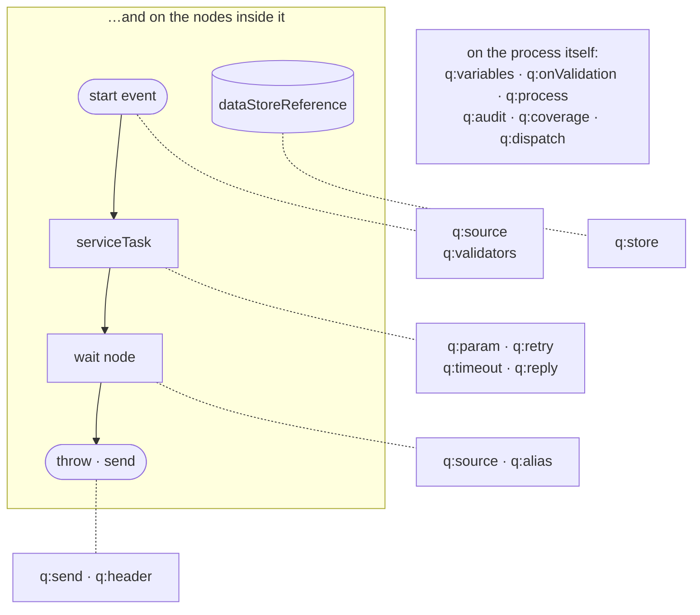
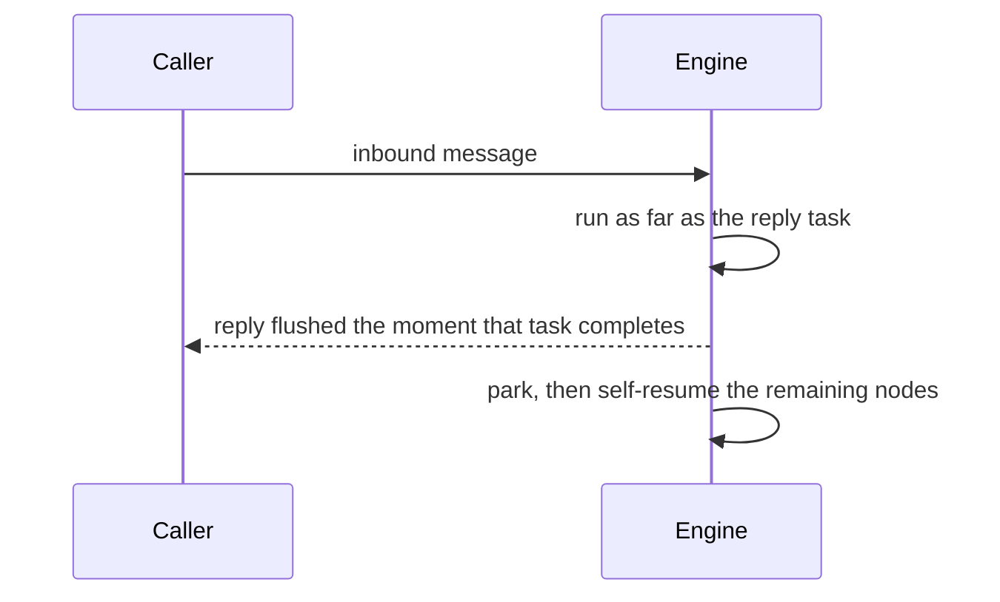

# The `q:` namespace

Standard BPMN 2.0 has no opinion on channels, message types, correlation, or replies. Sutra adds a
small, layered set of extension elements — the `q:` namespace, `urn:sutra:q:1.0` — that live
entirely inside `<bpmn:extensionElements>`, so a Sutra process is still a valid, portable BPMN 2.0
diagram; the `q:` attributes just tell the engine how to wire it to the outside world. The
authoritative shape is `xsd/q.xsd`; the engine's parser validates every `<q:*>` element against it,
and the same XSD drives the `sutra-modeler-plugin` property panels.

```xml
<bpmn:definitions xmlns:bpmn="http://www.omg.org/spec/BPMN/20100524/MODEL"
                  xmlns:q="urn:sutra:q:1.0" ...>
```

## At a glance

| Element | Attaches to | What it declares |
|---|---|---|
| `q:source` | start events, wait-capable nodes | The inbound trigger: channel, message type, ack mode, dedup, data class. |
| `q:validators` / `q:redactors` | `q:source` | The validation and redaction chains over the decoded payload. |
| `q:alias` | wait-capable nodes | A correlation key derived by FEEL — how a later inbound finds the parked instance. |
| `q:reply` | tasks | An outbound reply on the inbound's own channel; `continue="true"` is respond-and-continue. |
| `q:send` | throw events, send tasks | An unsolicited outbound message to a channel destination. |
| `q:header` | `q:send` / `q:reply` | An author-declared outbound header. |
| `q:decode` | data task (`bpmn:serviceTask` with no `@implementation`) | Parses text the flow holds, such as a message kept in a typed store column, with a registered codec, and binds the result (0.6.19). |
| `q:param` | `bpmn:serviceTask` | A scoped, per-invocation input to a registered task or template. |
| `q:retry` | registered-task **and** channel-call `bpmn:serviceTask` | Per-task retry policy — attempts, backoff, non-retryable codes. |
| `q:timeout` | channel-call `bpmn:serviceTask` | Synthesizes a timer boundary on the call. |
| `q:stream` (attribute) | channel-call `bpmn:serviceTask` | `q:stream="true"` streams a synchronous model answer to the original caller. Default `false`. |
| `q:store` | `bpmn:dataStoreReference` | Binds the reference to a durable key in a declared data store. |
| `q:dispatch` / `q:case` | `bpmn:process` | Content-based dispatch to called elements. |
| `q:variables` / `q:variable` | `bpmn:process` | Declared process variables — type or schema, `transient` / `sensitive` / `source`. |
| `q:onValidation` | `bpmn:process` | The structural-failure policy (`route` / `reject` / `error`). |
| `q:process` | `bpmn:process` | The retry-safety (idempotency) assertion. |
| `q:audit` | `bpmn:process` | Audit capture level (`none` / `metadata` / `payload` / `media`) and data-class tagging. |
| `q:coverage` | `bpmn:process` | An opt-in tracked compliance path. |



Nothing in the vocabulary is a new node type: every element hangs off a standard BPMN element's
extension elements, which is why a process carrying all of it is still a valid, portable BPMN 2.0
diagram.

## `q:source` — the inbound trigger

Every message-consuming node — a start event or a wait-state catch — declares exactly one
`q:source`. It names the channel, the message type it accepts, and the variable the decoded
payload lands in:

```xml
<bpmn:startEvent id="Start">
  <bpmn:extensionElements>
    <q:source channel="transfer-request" messageTypeValue="TransferRequest"/>
  </bpmn:extensionElements>
</bpmn:startEvent>
```

- `channel` (required) — the `channels.yaml` channel name.
- `messageTypeValue` / `messageTypePattern` — subscribe to one exact type, or a family via regex,
  matched against the codec's decoded message type. Neither set = accept anything the channel's
  codec yields.
- `name` (default `payload`) — the process-variable name the decoded body is projected under
  (`payload.fromId`, `payload.body.CdtTrfTxInf...` for a structured codec).
- `ack` (default `on-persist`) — see [Acknowledgement modes](../operating/ack-modes.md).
- `dedupKey` — an expression identifying a redelivered duplicate (e.g. `header.X-Request-Id`),
  distinct from the process-level retry-safety assertion below. `dedupKey` accepts `header.<name>`,
  `ce.id`, `body.<path>` and `amqp.message-id`; any other form is refused at lint, package and deploy
  with `SUTRA.PARSE.Q_SOURCE.DEDUP_KEY_UNRECOGNISED`. It dedupes on a start event and on a wait.
- `dataClass` (default `none`) — `pii` / `pci` / `phi` / `financial`; drives redaction policy.
- `filterExpression` — a FEEL predicate over the message *attributes* the codec reported. It
  narrows whichever of the message-type selectors above applies rather than replacing one, so
  "exact beats pattern beats accept-anything" is unchanged.

### Several waits on one channel {#several-waits-on-one-channel}

*Since 0.6.10.* A message on a channel that a WAIT subscribes to (a relay) chooses among the waits
by the same rules a start event uses: an exact `messageTypeValue` beats a `messageTypePattern`,
which beats a wait that declares no type, and `filterExpression` narrows within a tier. A wait
pinned to another message type never takes the message. Among the waits that accept it, the one
the correlated instance is actually parked at is resumed, the most specific first. So two waits on
one channel can be told apart by message type alone:

```xml
<bpmn:receiveTask id="WaitAnswer">
  <bpmn:extensionElements>
    <q:source channel="answers-in" name="answer" messageTypeValue="Answer"/>
    <q:alias name="answerRef" expression="answer.ref" unique="true"/>
  </bpmn:extensionElements>
</bpmn:receiveTask>
<bpmn:receiveTask id="WaitCancel">
  <bpmn:extensionElements>
    <q:source channel="answers-in" name="cancel" messageTypeValue="Cancel"/>
    <q:alias name="cancelRef" expression="cancel.ref" unique="true"/>
  </bpmn:extensionElements>
</bpmn:receiveTask>
```

Before 0.6.10 a relay ignored the wait's message type, and such waits needed a `filterExpression`
on `messageType` to stay apart. That still works.

### Selecting on attributes, not just a message type

One string cannot always say which process should handle a message. A message standard may use the
same message type in more than one flavour — the same type arriving one way is a request to act
on, and arriving the other way is an acknowledgement of something you sent — and the flavour, not
the type, decides the handler.

A codec reports those facts as **attributes** alongside the message type, and a start event
selects on the pair:

```xml
<q:source channel="rail" messageTypeValue="CreditTransfer"
          filterExpression="attr.direction = &quot;incoming&quot;"/>
```

Two start events may now pin the same message type and be told apart by an attribute, where before
that was an ambiguous handler. The predicate sees the attributes and `messageType` — not headers,
not the payload: admitting either would make the package-time checks below impossible and would
let one business message route differently depending on the transport it arrived over.

A codec declares the attribute keys it can report, and optionally their closed value domains.
`sutra lint` then refuses a predicate reading a key the bound channel's codec can never emit, or
comparing against a value outside its domain — so `"Incoming"` for `"incoming"` fails at package
time instead of producing a start event that silently never fires. It also refuses two subscribers
on one non-broadcast channel whose predicates it cannot *prove* disjoint; the recognised form is
`and` / `or` / `not` over equality, inequality, `in`, and relational comparisons on numeric
attributes. That limit is permanent rather than provisional: the gate is a proof obligation, and
arbitrary FEEL cannot be proven disjoint. A codec declaring no attributes is *open* — the
predicate still works and lint warns that it cannot verify it rather than blocking.

The codec itself is **not** declared on `q:source` — it comes from the channel (YAML is
authoritative for transport/codec binding; BPMN is authoritative for process flow). Declaring a
codec on `q:source` is a parse error.

### `q:validators` and `q:redactors` (nested under `q:source`)

```xml
<q:source channel="transfer-request" messageTypeValue="TransferRequest">
  <q:validators>
    <q:complexValidator source="transfer-limits.dmn"/>
    <q:complexValidator source="transfer-fields.srl"/>
    <q:simpleValidator ref="iso-4217-currency" path="payload.amount.currency"/>
  </q:validators>
  <q:redactors>
    <q:redactor ref="pci"/>
  </q:redactors>
</q:source>
```

`q:validators` is a mixed, ordered container: a `q:complexValidator` runs a whole-payload ruleset
(a `.dmn` or `.srl` file, or a built-in like `iso-xsd`) — a chain can mix `.dmn` and `.srl` entries
freely, run in declaration order, with every entry's issues accumulating into one result (see
[Composing a validator chain](rules.md#composing-a-validator-chain)); a `q:simpleValidator` checks
one field at a FEEL `path` against a registered content validator (`iso-3166-country`,
`iso-4217-currency`, `iso-9362-bic`). `q:redactors` names registered `ContentRedactor`s that mask
sensitive spans in every observability surface (audit, logs, traces) without touching the value
the flow actually sees.

## `q:reply` and `q:send` — outbound

```xml
<bpmn:serviceTask id="OkReply" implementation="transfer-result.hbs">
  <bpmn:extensionElements>
    <q:reply mode="native" contentType="application/xml"/>
  </bpmn:extensionElements>
</bpmn:serviceTask>
```

`q:reply` answers the caller that started this instance — `mode="native"` (default) preserves the
symmetric reply behavior, or emit a CloudEvent (`cloudevent-binary` / `cloudevent-structured` /
`match-inbound`). `q:send` is the unsolicited counterpart — an intermediate throw event emitting to
its own destination (`@destination` or `@channel`), with no inbound caller to answer. Both accept
`<q:header name="…" value="…"/>` children carrying FEEL-derived values onto transport
headers/application-properties.

`q:reply`'s `continue="true"` is respond-and-continue: flush the reply the moment the task
completes, then park the instance and self-resume the remaining nodes asynchronously — the caller
gets its answer without waiting on the tail of the flow.

A flow with no `<q:reply>` answers a synchronous HTTP call with `200` and an empty body; see
[Upgrading to 0.6.18](../operating/upgrading-0-6-18.md).



The caller's answer is bounded by the task that produces it rather than by the tail of the process
— the remaining nodes run on a resume nobody is waiting on.

### The contract an outgoing message must satisfy

A message a flow produces is held to a codec's contract before it leaves, the same way an inbound
message is held to one on the way in. The codec's own decode step *is* the validator, so the check
is literally "read back what we are about to send" — there is no second contract to keep in step
with the first.

This matters most for output a template, script or decision produces. Those renders reach the wire
without passing through an encode step at all, so without this check an engine that validates every
byte it accepts would validate none of the bytes it emits — and a flow could answer a
strictly-validated request with a structurally invalid message.

| Attribute on `q:send` / `q:reply` | Means |
|---|---|
| `codec="urn:…"` | the codec whose contract this output must satisfy, stated rather than inferred |
| `messageType="…"` | the message type this output emits — checked against what that codec can produce |

```xml
<bpmn:serviceTask id="Answer" implementation="ack.hbs">
  <bpmn:extensionElements>
    <q:reply codec="urn:acknowledgements" messageType="Acknowledgement"/>
  </bpmn:extensionElements>
</bpmn:serviceTask>
```

State the codec when the output's contract is not the one the bytes happen to leave by. A flow is
a translator: it may accept one wire format and answer or forward in another, so the codec that
decoded the request need not govern the answer.

The two forms differ in what happens when you say nothing, and the asymmetry is deliberate:

- **A `<q:send>` infers** the codec of the `@channel` it names. That is not a guess — the bytes
  are addressed to that channel, and its codec is exactly what the consumers there will decode
  them with. A `<q:send destination="…">` names an endpoint rather than a channel and so has
  nothing to infer from, which makes stating the codec the only way to hold it to a contract.
- **A `<q:reply>` infers nothing**, and is unvalidated unless you state one. The tempting
  fallback is the channel the reply rides back out on, but a channel's codec is the contract its
  *requests* satisfy, and a reply is by definition a different message — a codec bound to
  validate a transfer request has no declaration for the acceptance that answers it, so
  inferring it would reject correct replies.

A failure is refused rather than sent (`SUTRA.OUTBOUND.VALIDATION_REJECT`), and the diagnostic
names the offending field. The default is fail-closed for the same reason
[`q:onValidation`](#qonvalidation--the-structural-failure-policy)'s is: a flow that declared no
posture toward a validation failure has said nothing about handling one, so the invalid message
must not leave. Egress bound to a bare format, or to no codec, asserts no schema and is
unaffected — there is nothing there to fail.

Where the refusal lands depends on where the step runs. On a request the caller is driving, it
comes back to that caller as the error, and nothing is persisted. On a resumed step (the tail
after a `<q:reply continue="true">`, a timer, a `<q:retry>` re-drive, a relayed message), there
may be no caller left to tell, so the instance fails instead. It is marked FAILED with this code
(the `failureCode` on `GET /sutra/instances/{id}`), and its waits and timers are resolved so
nothing re-runs.

`sutra lint` moves what it can to package time. It reads a template's own *unrendered* text with
the governing codec and compares the answer against `template-manifest.yaml` — `outputMessageType`,
and `outputAttributes` for the codec-reported attributes. That works because a template is text
with holes and the holes are leaf content: the element structure deciding classification is already
there. It catches a template that renders the wrong message while declaring the right one. A
template the codec cannot classify unrendered is reported unverifiable rather than wrong; a
*stated* codec that does not resolve is an error, because stating it is how you ask for the check.

## `q:alias` — correlation by your business key

```xml
<q:alias name="e2eId" expression="payload.E2EId" unique="true" onConflict="correlate"/>
```

A friendly key derived from a FEEL expression over the process variables — durable, and
re-evaluated on rehydration. `unique="true"` with `onConflict="correlate"` is what lets a later
message on a different channel find and resume the exact parked instance it belongs to, by a key
*you* named (an `EndToEndId`, an order reference) rather than an engine-internal id. See
[Wait states and human tasks](wait-states.md). A correlation alias's value also appears in an acceptance
receipt, masked if sensitive; see [Acceptance receipts](acceptance-receipts.md).

## `q:receipt` — what a 202 names

An HTTP channel with `ack-mode: on-persist` answers `202 Accepted` with a receipt the engine writes
itself, so a caller learns which instance it started without the flow doing anything:

| Field | What it is |
|---|---|
| `instanceId` | The instance started or resumed: the handle for `GET /sutra/instances/{id}`. |
| `deploymentId`, `labels` | The deployment serving the channel, and its `tenant`, `module`, `version`. |
| `aliases` | The instance's `<q:alias>` values at the moment of the answer, masked by the rules below. |
| `idempotencyKey` | The key the caller supplied, or the one a `<q:source dedupKey>` derived. Absent otherwise: the body hash used in its place recognises no retry. |
| `duplicate`, `originalInstanceId` | This delivery was already seen; the instance the first one started. |
| `attributes` | The values the flow chose to expose, below. |

It travels in two headers: `Sutra-Instance-Id` and `Sutra-Receipt` (the whole receipt as one line of
ASCII JSON, cut down to its identifying fields with `"truncated": true` if it would pass 4 KiB). A
flow that replied nothing also gets it as the `application/json` body; a body the flow authored with
`<q:reply continue="true">` is left untouched. Other channels answer as before, except that a duplicate on
any HTTP channel gets this 202. Queue transports have no synchronous answer, so no
receipt.

`<q:receipt>` adds values of the flow's choosing. It hangs off the process's own
`extensionElements`, and without it the flow exposes nothing:

```xml
<bpmn:process id="case-open">
  <bpmn:extensionElements>
    <q:receipt>
      <q:attribute name="caseId" expression="req.caseId"/>
    </q:receipt>
  </bpmn:extensionElements>
```

**When it is evaluated.** At the answer, over the variables a `<q:reply continue="true">` renders
against: everything the intake bound, plus what the flow computed before replying or parking.

**What is masked.** An expression reading a `sensitive` variable shows `***REDACTED***`, an alias
included. One reading a redactor-controlled variable shows that path of its masked projection, or the
mask if it is not a plain path. While a redactor is active, anything under `event` other than
`channel`, `contentType`, `dedupKey`, `idempotencyKey` and `receivedAt` is masked too, since it
repeats the payload. A null is left out, and an expression that fails to evaluate is left out and
logged: the work is already accepted and does not fail over its receipt. Values are strings.

`sutra lint` refuses an expression that does not parse and a repeated name
(`SUTRA.CONFIG.RECEIPT.ATTRIBUTE_DUPLICATE`), and warns about an attribute reading a sensitive
variable (`SUTRA.CONFIG.RECEIPT.ATTRIBUTE_SENSITIVE`), since the caller would only ever see the mask.

**A duplicate's receipt** names the original instance, and carries no aliases or attributes: nothing
ran to produce them. It names no instance when the first delivery ended without one or was recorded
before 0.6.18.

**A caller that lost its 202** can ask `GET /sutra/instances?alias=<name>:<value>`. See
[Acceptance receipts](acceptance-receipts.md#6-find-the-instance-after-losing-the-202).

## `q:decode` — read held text as a message

`event.body` is the message as text, so a flow can keep it in a typed store column with an ordinary
assignment. `<q:decode>` is the other half: it parses text the flow holds with a registered codec and
binds the result. It hangs off a data task, and anywhere else is a parse error
(`SUTRA.PARSE.Q_DECODE.NOT_ON_DATA_TASK`). The walkthrough is
[Keeping a message as text](data-stores.md#keeping-a-message-as-text).

```xml
<bpmn:serviceTask id="Load">
  <bpmn:extensionElements>
    <q:decode name="message" expression="row.body" codec="json" contentType="row.contentType">
      <q:redactors><q:redactor ref="card"/></q:redactors> <!-- optional -->
    </q:decode>
  </bpmn:extensionElements>
  <bpmn:dataInputAssociation>
    <bpmn:sourceRef>refRead</bpmn:sourceRef><bpmn:targetRef>row</bpmn:targetRef>
  </bpmn:dataInputAssociation>
</bpmn:serviceTask>
```

| Attribute | Required | What it is |
|---|---|---|
| `name` | yes | The variable the decoded value is bound to. |
| `expression` | yes | FEEL giving a string. |
| `codec` | yes | A built-in format name or a package schema codec URN, as on a channel. |
| `contentType` | no | FEEL. Picks the parser within a format's contract (`json`, `xml` and `yaml` are one contract), and is passed to the codec. |

**Order.** A data task runs its store reads, its decodes in document order, its assignments, then its
store writes.

**The instance's own codec.** It resolves in the instance's pinned deployment, so a redeploy does not
change how an old instance decodes. Validators and `<q:onValidation>` do not run: this is not intake.
A codec's non-fatal issues do not stop the step.

**Failures** can be caught with an error boundary or an event sub-process. Uncaught, they fail the
instance. Their text names issue codes and paths only, never the input.

| Code | When |
|---|---|
| `SUTRA.RUNTIME.DECODE.NOT_TEXT` | The expression gave null or something other than a string. A timer start has no `event`, so `event.body` there gives this. |
| `SUTRA.RUNTIME.DECODE.FAILED` | The codec refused the text or its content type, or the codec or a redactor isn't registered. |
| `SUTRA.RUNTIME.DECODE.TOO_LARGE` | The text is over the engine's `sutra.codec.max-payload-bytes` (10 MiB by default; `0` there still leaves that default here). Nothing was decoded. |

**Text only.** A valid UTF-8 body round-trips exactly. Otherwise invalid bytes become U+FFFD in
`event.body`, and `event.bodyLossy` is `true`, so a flow can route the message away; a clean message
has no such key. There is no binary form. A body whose prolog declares another encoding, such as
ISO-8859-1 XML, cannot be kept faithfully. A NUL byte survives the conversion but PostgreSQL `TEXT`
refuses it, and that store write fails the instance.

**Masking.** A `<q:redactors>` child writes a masked projection to the `<name>.redacted` companion,
and a crashed redactor masks the whole value. Otherwise declare the target `sensitive`. A store column
has no at-rest encryption, and `sensitive` does not reach it. In a package where a process masks its
source, `sutra lint`:

| Code | Severity | When |
|---|---|---|
| `SUTRA.CONFIG.BPMN.RAW_BODY_UNMASKED` | warning, an error in a later release | A variable holds raw `event.body` text and isn't `sensitive`. This covers a copy, and a variable read from a store that a masking process wrote it to, even in a process with no masking of its own. |
| `SUTRA.CONFIG.BPMN.RAW_BODY_STORED` | warning | Raw `event.body` text is written to a store. |
| `SUTRA.CONFIG.DECODE.REDACTORS_MISSING` | error | A `<q:decode>` reads such text, and its target has neither `<q:redactors>` nor `sensitive`. |

The check follows a store by name within one package; another package reading the same database isn't
seen, and `<q:alias>` and `<q:param>` don't count as copies. It also refuses a codec or redactor that
doesn't resolve (`SUTRA.CONFIG.DECODE.CODEC_UNKNOWN`, `SUTRA.CONFIG.DECODE.REDACTOR_UNKNOWN`), and a
step missing an attribute fails at parse (`SUTRA.PARSE.Q_DECODE.INCOMPLETE`).

**After a wait.** A decode reads variables and store rows, never a delivery, so a resume or a retry
decodes the same text. But a resuming message replaces `event`, and so does a synchronous channel-call
reply unless the task declares an output mapping. So capture on the step right after the intake you
mean. A call activity sees its caller's `event`.

**Cost.** The decoded target and any capture variable are persisted at a park like any other, so a
large message costs two or three times its size per park unless declared `transient`. A flow that
doesn't use `<q:decode>` pays nothing.

## `q:retry` — per-task retry policies {#qretry--per-task-retry-policies}

```xml
<bpmn:serviceTask id="Score" implementation="registered:score">
  <bpmn:extensionElements>
    <q:retry maxAttempts="3" initialDelay="PT1S" backoffCoefficient="2.0"
             maxDelay="PT5M" nonRetryableCodes="SUTRA.TASK.VALIDATION"/>
  </bpmn:extensionElements>
</bpmn:serviceTask>
```

Valid on **both** kinds of `<bpmn:serviceTask>` — a registered task and a channel-call task
(`implementation="channel:<name>"`). `maxAttempts` is the total invocation budget including the
first attempt; attempt *n+1* waits `min(initialDelay × backoffCoefficient^(n-1), maxDelay)`;
`nonRetryableCodes` names structured codes that fail immediately regardless of budget.

The load-bearing property: **a retry wait is a durable timer park, never a sleep.** The instance
persists with the failed task still pending and an armed timer at the backoff instant, so the
backoff survives restarts and hot-deploys and blocks no execution lane.

What counts as a failed attempt is deliberately narrow. On a registered task: an uncaught error
from the task function. On a **channel-call** task, exactly two things — the route-less
`<q:timeout>` boundary firing, and the request delivery being terminally poisoned by the outbox
attempt ceiling. A correlated **business response is never a retry trigger** (the counterpart
answered; re-sending would double-submit), and BPMN errors always route to their boundaries
instead. Because a modelled outcome always beats a policy, a channel-call `<q:retry>` requires the
route-less `<q:timeout>` form — a timer boundary with drawn outgoing flows alongside a retry
policy is a load error.

`@initialDelay` and `@maxDelay` may be FEEL expressions instead of literals, for example
`initialDelay="config.retryDelay"`. They are evaluated each time a backoff is armed.

Full treatment, including the re-drive's fresh-idempotency-key contract and what exhaustion does:
[Retries, history, and schedules](retries-history-schedules.md#qretry--a-per-task-retry-policy).

## `q:timeout` — a deadline on a channel call

```xml
<bpmn:serviceTask id="Score" implementation="channel:score-request">
  <bpmn:extensionElements>
    <q:timeout duration="PT2M"/>
  </bpmn:extensionElements>
</bpmn:serviceTask>
```

Synthesizes a timer boundary on the call, so a counterpart that never answers cannot park the
instance forever. Without a `<q:retry>` alongside it, a fired route-less timeout is a catchable
BPMN error; with one, it is a retryable task failure first.

`@duration` may also be a FEEL expression, such as `duration="request.budget"` or
`duration="config.callTimeout"`. It is evaluated when the call parks. See
[Timer intervals from FEEL](retries-history-schedules.md#timer-intervals-from-feel).

## `q:stream` — stream a channel-call answer

`q:stream` is an optional boolean **attribute** (not an element) on a `bpmn:serviceTask`. Writing
`q:stream="true"` on a channel-call task (`implementation="channel:<name>"`) marks it as one whose
synchronous model answer should be streamed to the original caller, while the complete answer is
still accumulated and resumes the flow as an ordinary response. It defaults to `false`, and omitting
it changes nothing. Declaring it `true` on a task whose implementation is not a channel call fails
the load with `SUTRA.CONFIG.BPMN.STREAM.NOT_CHANNEL_CALL`; a value that is not `true`/`false` fails
with `SUTRA.CONFIG.BPMN.STREAM.INVALID`. The attribute is a backwards-compatible addition to the
frozen `urn:sutra:q:1.0` namespace. See [Calling a language model](llm-channels.md#streaming-to-the-caller).

## `q:store` — durable, cross-instance data

```xml
<bpmn:dataStoreReference id="dsrFrom" name="accounts" dataStoreRef="accountsStore">
  <bpmn:extensionElements>
    <q:store key="payload.fromId" forUpdate="true"/>
  </bpmn:extensionElements>
</bpmn:dataStoreReference>
```

Binds a `<bpmn:dataStoreReference>` to a key in a `datastores.yaml`-declared store. `forUpdate`
takes a pessimistic row lock (serializes concurrent writers on the same key); `field` replaces one
field of a stored map value; `expect="unchanged"` is an optimistic compare-and-set instead of a
lock; `expect="absent"` (0.6.10) writes only when the key does not exist yet — a claim exactly one
replica wins. A lost compare-and-set raises `SUTRA.RUNTIME.DATASTORE.CONFLICT`, which an error
boundary on the data task can catch.

On a read, `query` (0.6.10) turns the binding into a key query: every row whose key starts with
`key` (`query="prefix"`) or lies in `[key, to)` (`query="range"`), keys compared bytewise, in key
order, `limit` per page (default 1000, maximum 10 000) after the key `after`; `rows="false"`
returns aggregates only. Each child `<q:aggregate fn="count|sum" field="…" groupBy="…"/>` is
computed over every matching row:

```xml
<q:store key="payload.meter + '|' + payload.day + '|'" query="prefix" limit="500" after="payload.after">
  <q:aggregate fn="sum" field="kwh"/>
  <q:aggregate fn="sum" field="kwh" groupBy="kind"/>
</q:store>
```

The target variable receives `{rows: [{key, value}], aggregates: [...], truncated, next}`. See
[Querying rows by key](data-stores.md#querying-rows-by-key) for the result shape, the number rules
and the index the store's table needs.

## `q:dispatch` / `q:case` — a routing table instead of gateway sprawl

```xml
<q:dispatch default="fallback" onNoMatch="error">
  <q:case when="payload.type = 'A'" calledElement="handle-a"/>
  <q:case when="payload.type = 'B'" calledElement="handle-b"/>
</q:dispatch>
```

A declarative dynamic call-activity dispatch — one FEEL condition per case, instead of an
exclusive gateway fanning into N call activities.

## `q:onValidation` — the structural-failure policy

```xml
<q:onValidation mode="route" errorCode="T505"/>
```

`mode="route"` surfaces the `validation` summary (`outcome`, `tier`, `firstReasonCode`,
`firstIssue`, `issues`) as variables so the BPMN's own gateway decides what to do; `reject` /
`error` short-circuit. The engine never interprets what
a soft error *means* — that decision stays in your process, which is what keeps the engine
domain-neutral.

The three modes are not interchangeable:

| Mode | What happens |
|---|---|
| `route` | the payload reaches the flow; you triage `payload.validation.issues` yourself |
| `reject` | the message is refused at intake; no instance starts; the caller gets the issue list |
| `error` | a BPMN error is raised *into* the flow, for an error boundary or event sub-process to catch |

**Declaring nothing means `reject`.** An intake that carries a validation *contract* — a
schema-backed codec, or a declared `<q:validators>` chain — and states no policy refuses a failing
payload rather than passing it on. A flow that says nothing about handling failure has no handler
for it by definition, so the failure must not enter it.

That default is `reject` rather than `error` deliberately: `error` is still the flow taking
control, and raising a BPMN error into a process with no matching boundary reports "uncaught BPMN
error" instead of naming the offending field — a worse diagnostic for the same refusal.

Schema-less ingress is untouched. A channel binding a bare format (`csv`, `json`, …) has no
contract to fail, and the format layer is fail-open by construction, so nothing changes there.

If you want the payload through regardless, say so — `<q:onValidation mode="route"/>` — and the
intent is visible in the diagram instead of resting on a default. `sutra lint` warns
(`SUTRA.CONFIG.VALIDATION.POSTURE_UNDECLARED`) on any contract-bearing intake that declares no
policy, naming both choices.

## `q:process` — the retry-safety assertion

```xml
<bpmn:extensionElements><q:process idempotent="true"/></bpmn:extensionElements>
```

Hung off the `<bpmn:process>` itself. `idempotent="true"` is your assertion that re-running this
process on the same input converges to one end state — so a redelivered message is safe to
re-process any number of times. The default is `false` (fail-closed): an execution failure on a
non-idempotent process is consumed (ack, no requeue) and recorded as an incident rather than
blind-retried. This is a different concern from `q:source`'s `dedupKey`, which only detects that a
message *is* a redelivery — it says nothing about whether re-processing it is safe.

**What the assertion gates, and what it does not.** It governs the *failure* path: whether a
delivery that failed is requeued or dead-lettered. It does **not** gate replay after a park. An
instance that parks — at a wait node, a `<q:retry>` backoff, or a `<q:reply continue="true">` — is
re-driven at-least-once by the durable poller, unconditionally. A multi-instance loop is one
durable step, so a crash mid-loop replays it from the first item rather than resuming where it
stopped.

Both rest on the same property: every effect the flow repeats must converge. A store write keyed
by something derived from the record does (re-writing is an upsert). A `<q:send>`, an append, or a
counter increment does not — and no assertion makes it so. Declaring `idempotent="true"` over
effects that do not converge does not make replay safe; it only changes what happens after a
failure.

## `q:variables`, `q:audit`, `q:coverage`

- **`q:variables`** — declares process variables up front (name + scalar type or a schema
  reference), so deploy-time static validation can check every FEEL path against them, and mark a
  variable `transient` (never persisted, so it is dropped at any park — reading it after a wait
  state, a `<q:retry>` backoff or a `<q:reply continue="true">` is a validation error; it is for
  scratch that is re-derived, never for anything the flow still needs on the other side),
  `sensitive` (persisted but redacted downstream), or `source`-bound (payload-initialized from a
  named channel).
- **`q:audit`** — per-process audit sink/target/capture-level configuration. `capture` is `none`,
  `metadata`, `payload` (the default) or, since 0.6, `media`: metadata-level events that carry the
  media references found among the variables, never the media (see
  [Recordings and media references](recordings-and-media.md#the-audit-trail-carries-references-never-media)).
- **`q:coverage`** — declares one tracked compliance route (`path` id + the ordered `flows` it must
  traverse) for the path-coverage reporting the CLI's `sutra coverage` commands drive. This is the
  intra-process half of the mechanism; a route spanning several correlated processes is declared
  differently. See [Coverage: declared routes as the compliance signal](coverage.md) for both
  shapes, the curation guidance, and the CLI walkthrough.

## Next

- **[Rules: DMN, FEEL, and .srl](rules.md)** — the decision layer these expressions run on.
- **[Retries, history, and schedules](retries-history-schedules.md)** — `q:retry` and `q:timeout`
  end to end, plus timer definitions and execution history.
- **[Worked example: money-transfer](worked-example.md)** — most of the elements on this page, in
  one real process.
