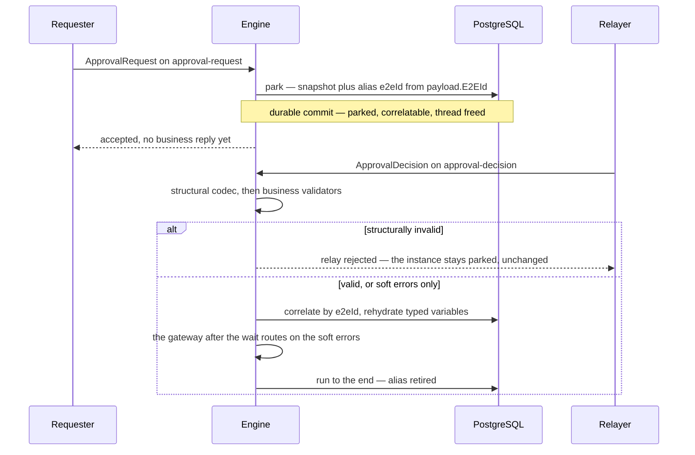

# Wait states and human tasks

Sutra's wait state is an **integration point that waits for an external relay decision** — not a
human-task management system. When a token reaches one, the engine suspends the instance
(persists it, frees the thread); the flow continues only when an external actor — a human via a
console you build, or another system — relays a decision back through a channel as a typed
message. The engine rehydrates and runs to completion.

| Sutra (the engine) provides | You own |
|---|---|
| The wait point + durable suspend / rehydrate / resume | Human-task management: assignment, queues, claim, escalation, SLA |
| A relay channel (typed message in) | Forms and any UI |
| The held instance variables, carried verbatim | Identity / authentication / authorization (who may relay) |
| Compliance-grade audit of the wait and the relayed decision | Notifications, dashboards |

That split is deliberate: full human-task management and forms are a much larger scope than a
workflow engine's core job, and Sutra doesn't try to own them.

## The construct: an intermediate message catch event

The honest BPMN construct is the **intermediate message catch event** — "pause until message *M*
arrives, then continue." A `userTask` is the human-facing flavor of the exact same machinery, for
authors who think in terms of "a human decides here" — it carries no assignee/group/queue model in
the engine; if present, those are just opaque hints in instance variables.

An intake node for a wait declares a channel exactly like a start event's `q:source` — the relayed
message goes through the same two-tier validation pipeline (structural codec, then business
validators) that every inbound message does. The difference is only in what happens after:

| Outcome | Start event (new instance) | Wait state (relay) |
|---|---|---|
| Structurally invalid | No instance minted; error to caller | **Relay rejected; the instance stays parked, unchanged** |
| Soft errors | Minted and run; surfaced as variables | Rehydrated and resumed; the gateway *after* the wait routes on the soft errors |
| Valid | Minted and run | Rehydrated and resumed |

The load-bearing property: **the wait is the safe state.** A hard-invalid relay can never advance
or corrupt a parked instance — it is rejected and the instance sits exactly where it was. The
relayer fixes the message and retries.

## Correlation by a business key you name

```xml
<q:alias name="e2eId" expression="payload.E2EId" unique="true" onConflict="correlate"/>
```

The relayed message doesn't carry an engine-internal instance id — it carries a business value
(an `EndToEndId`, an order reference, whatever your domain already uses), and the process declares a
`q:alias` deriving that key from its own payload. The engine indexes it durably, on PostgreSQL, so
correlation survives a restart and works identically across every replica. See
[The q: namespace](q-namespace.md) for the full `q:alias` shape.

A relay is matched by the start event's alias even when the wait binds its message under a name of
its own (`<q:source channel="revision" name="revision"/>`): while the alias is evaluated, the
relayed message is also visible under the start event's payload name, so `payload.E2EId` reads the
relayed `E2EId`. The name a wait gives its payload is local to that wait. It is what the steps
after it read (`revision.note`), and it does not change which instance a message finds.



The park is a commit, not a pause: the correlation key is written in the same durable step that
suspends the instance, so a relay arriving later — on a different channel, against a different
replica — finds it by the key you named. And because a hard-invalid relay is refused *before*
anything is rehydrated, the parked instance is never the thing that pays for a bad message.

## Variables survive the wait **typed**

The instance variables held across a wait keep their real types. A number comes back a number, a
boolean a boolean, a list a list, a context a context, a date/time/duration its own temporal type
— and **a null comes back null**, not an empty string.

This matters because FEEL, correctly, does not coerce. A gateway condition after a wait therefore
evaluates against the value's real type:

| After the wait | Evaluates as |
|---|---|
| `amount > 100` where `amount` parked as `1250.75` | a number comparison — `true` |
| `not(approved)` where `approved` parked as `false` | a boolean negation — `true` |
| `cancelledAt = null` where nothing was ever set | `true` |

Two things are deliberately unchanged. First, **the inspect projection is not affected**: every
variable still renders through the display form it always had on `GET /admin/instances/{id}`, so
what an operator's response looks like did not move — typing changed what survives a wait, not
what is shown. (A null now renders as `null` rather than blank, which is the one visible
difference, and it is the correct one.) Second, **the correlation key input is not affected**:
a subject blind-index value keeps hashing the exact string it always hashed.

Two value kinds still persist as their canonical string, because neither is really instance state:
a FEEL **function** closes over an evaluation context that ceases to exist the moment the instance
parks, and a **range** is a comparison shape rather than a value. Both behaved this way before and
still do.

The [design reasoning](../internals/durable-execution.md#the-typed-value-encoding) — the encoding,
the compatibility posture, and why encrypted values are typed too — is in the internals chapter.

## Waiting at the same node again: loops

Since 0.6, a process instance can wait at the same node any number of times. A loop that brings
the token back to a message catch, a receive task, a user task, a channel call (async or
synchronous), a timer catch or an event-based gateway parks a **new** wait on each pass, with its
own wait row, its own timer and `<q:timeout>` rows, its own `<q:retry>` budget and its own
`<q:alias>` rows. The step that answers a pass resolves that pass's rows and retires its
correlation keys, so a late message for a past pass resumes nothing. Before 0.6 the token found
the node already done and ran past it, or the instance could not park there again.

Behind this, a resume continues from the satisfied node itself instead of replaying the graph
from the start event. Nothing upstream runs again, other parked waits carry over untouched, and a
converging gateway regains its earlier arrivals from a side-effect-free walk over the completed
nodes. The snapshot format is unchanged, so instances parked by an earlier engine resume under
the new rules.

Related rules that came with it:

- A message that correlates to an instance but names a wait the instance is not parked at is
  refused before anything runs, with `SUTRA.RUNTIME.RESUME.NOT_WAITING`.
- A wait node's own `<q:alias>` (on a message catch, receive task or user task) is indexed when
  the node parks, so a message correlates by it.
- An **event-based gateway** continues along the arm that fired when the instance resumes.
- A **parallel join** inside a loop waits for a full set of tokens each time round.
- A message on a channel that several wait nodes of one process subscribe to resumes the node the
  instance is parked at.

### Walkthrough: a review loop

The `examples/review-loop` package sends a draft round review, revision and a short cool-off
until a reviewer approves it:

```
POST /channels/drafts            { draftId }                     rounds := 0
  AwaitReview    user task, answered on POST /channels/drafts/review { draftId, decision }
  Count          rounds := rounds + 1
  Decide         review.decision = "approve" -> End
                 otherwise -> AwaitRevision (message catch, POST /channels/drafts/revision)
                           -> CoolOff (timer catch, PT2S) -> back to AwaitReview
```

The loop is ordinary BPMN: `AwaitReview` has two incoming flows, one from the start and one back
from `CoolOff`:

```xml
<bpmn:userTask id="AwaitReview" name="Review the draft">
  <bpmn:extensionElements>
    <q:source channel="review" name="review"/>
  </bpmn:extensionElements>
  <bpmn:incoming>F2</bpmn:incoming><bpmn:incoming>F8</bpmn:incoming>
  <bpmn:outgoing>F3</bpmn:outgoing>
</bpmn:userTask>
…
<bpmn:intermediateCatchEvent id="CoolOff" name="Cool-off, 2 s">
  <bpmn:incoming>F7</bpmn:incoming><bpmn:outgoing>F8</bpmn:outgoing>
  <bpmn:timerEventDefinition id="CoolOff_Timer">
    <bpmn:timeDuration>PT2S</bpmn:timeDuration>
  </bpmn:timerEventDefinition>
</bpmn:intermediateCatchEvent>
<bpmn:sequenceFlow id="F8" sourceRef="CoolOff" targetRef="AwaitReview"/>
```

Every message after the first finds the instance through the start event's
`<q:alias name="draftId" expression="payload.draftId" unique="true" onConflict="correlate"/>`.
The waits bind their messages under names of their own (`name="review"`, `name="revision"`), and
`Decide` reads `review.decision`; the alias still reads `payload.draftId`, because a wait's name is
local to it. The process declares `<q:audit capture="metadata"/>`, so each step is in the
instance's audit history.

**Prerequisites:** [Before you try a walkthrough](../whats-new-0-6.md#before-you-try-a-walkthrough).

**1. Start the stack and deploy the package.** The `waits` helper lists the instance's wait rows
from the engine database:

```bash
C=examples/review-loop/deploy/compose.yaml
docker compose -f $C up -d --wait
sutra package examples/review-loop/deployments-src/default--review--1.0.0 \
    --out examples/review-loop/deploy/deployments 2>/dev/null
PORT=$(docker compose -f $C port engine 8080 | cut -d: -f2)
H=(-H 'Content-Type: application/json' -H 'X-Api-Key: dev-only-review-key')
until curl -sf "http://127.0.0.1:$PORT/sutra/deployments" | grep -q '"phase":"Active"'; do sleep 1; done
send() { curl -s -w " HTTP %{http_code}\n" -X POST "http://127.0.0.1:$PORT/channels/drafts$1" "${H[@]}" -d "$2"; }
waits() {
  docker compose -f $C exec -T engine-db psql -U postgres -d sutra -At -c \
    "select node_id, kind, status from waiting_event order by created_at"
}
```

```text
packaged examples/review-loop/deploy/deployments/default--review--1.0.0.sutra (deploymentId dep-84173f6525975bed01d706ee)
```

**2. Submit a draft.** It parks at the review:

```bash
send "" '{"draftId":"d-1"}'
ID=$(curl -s "http://127.0.0.1:$PORT/admin/instances/by-alias/draftId/d-1" | python3 -c 'import json,sys; print(json.load(sys.stdin)["instanceId"])')
waits
```

```text
 HTTP 200
AwaitReview|MESSAGE|WAITING
```

**3. Round one: ask for a revision, submit it, and let the cool-off run:**

```bash
send /review '{"draftId":"d-1","decision":"revise"}'
waits
send /revision '{"draftId":"d-1"}'
waits
sleep 4
waits
```

```text
 HTTP 200
AwaitReview|MESSAGE|RESOLVED
AwaitRevision|MESSAGE|WAITING
 HTTP 200
AwaitReview|MESSAGE|RESOLVED
AwaitRevision|MESSAGE|RESOLVED
CoolOff|TIMER|WAITING
AwaitReview|MESSAGE|WAITING
AwaitRevision|MESSAGE|RESOLVED
CoolOff|TIMER|RESOLVED
```

After the timer fired, the token came back to `AwaitReview`, and its wait is armed again
(`WAITING`) for round two.

**4. Round two, and a message for a wait the instance has left.** The second review asks for
another revision. A third review arrives while the instance waits for that revision, so it is
refused and nothing runs:

```bash
send /review '{"draftId":"d-1","decision":"revise"}'
send /review '{"draftId":"d-1","decision":"approve"}'
```

```text
 HTTP 200
{"type":"urn:bpm:diag:SUTRA.RUNTIME.RESUME.NOT_WAITING","title":"SUTRA.RUNTIME.RESUME.NOT_WAITING","status":500,"detail":"Instance 43a748ee-92ef-4845-bf59-10492c4b45ee is not waiting at 'AwaitReview' (it is parked at [\"AwaitRevision\"]); this relay on channel 'review' arrived for a wait the instance already left and is refused — nothing was executed.","code":"SUTRA.RUNTIME.RESUME.NOT_WAITING","attributes":{"instanceId":"43a748ee-92ef-4845-bf59-10492c4b45ee","nodeId":"AwaitReview"}} HTTP 500
```

**5. Finish round two, then approve in round three:**

```bash
send /revision '{"draftId":"d-1"}'
sleep 4
curl -s "http://127.0.0.1:$PORT/admin/instances/$ID" | python3 -c 'import json,sys; r=json.load(sys.stdin); print(r["status"], r["variables"]["rounds"])'
send /review '{"draftId":"d-1","decision":"approve"}'
curl -s "http://127.0.0.1:$PORT/admin/instances"; echo
```

```text
 HTTP 200
SUSPENDED 2
 HTTP 200
{"instances":[]}
```

Before the last review, the instance was parked at `AwaitReview` for the third time with
`rounds = 2`. The approval ended it, so no instance is live any more.

**6. Read the audit history.** The journal is written asynchronously, so the loop waits for the
completion event. Each event's `ordinal` is its position in the journal, which is what the history
pages by:

```bash
until curl -s "http://127.0.0.1:$PORT/admin/instances/$ID/history" | grep -q INSTANCE_COMPLETED; do sleep 1; done
curl -s "http://127.0.0.1:$PORT/admin/instances/$ID/history" | python3 -c '
import json, sys
for e in json.load(sys.stdin)["events"]:
    print(e["ordinal"], e["eventType"], e["nodeId"] or "")'
```

```text
1 INSTANCE_STARTED
2 NODE_ENTERED Start
3 NODE_LEFT Start
4 NODE_ENTERED Init
5 NODE_LEFT Init
6 NODE_ENTERED AwaitReview
7 INSTANCE_SUSPENDED
8 INSTANCE_RESUMED
9 NODE_LEFT AwaitReview
10 NODE_ENTERED Count
11 NODE_LEFT Count
12 NODE_ENTERED Decide
13 NODE_LEFT Decide
14 NODE_ENTERED AwaitRevision
15 INSTANCE_SUSPENDED
16 INSTANCE_RESUMED
17 NODE_LEFT AwaitRevision
18 NODE_ENTERED CoolOff
19 INSTANCE_SUSPENDED
20 INSTANCE_RESUMED
21 NODE_LEFT CoolOff
22 NODE_ENTERED AwaitReview
23 INSTANCE_SUSPENDED
24 INSTANCE_RESUMED
25 NODE_LEFT AwaitReview
26 NODE_ENTERED Count
27 NODE_LEFT Count
28 NODE_ENTERED Decide
29 NODE_LEFT Decide
30 NODE_ENTERED AwaitRevision
31 INSTANCE_SUSPENDED
32 INSTANCE_RESUMED
33 NODE_LEFT AwaitRevision
34 NODE_ENTERED CoolOff
35 INSTANCE_SUSPENDED
36 INSTANCE_RESUMED
37 NODE_LEFT CoolOff
38 NODE_ENTERED AwaitReview
39 INSTANCE_SUSPENDED
40 INSTANCE_RESUMED
41 NODE_LEFT AwaitReview
42 NODE_ENTERED Count
43 NODE_LEFT Count
44 NODE_ENTERED Decide
45 NODE_LEFT Decide
46 NODE_ENTERED End
47 NODE_LEFT End
48 INSTANCE_COMPLETED
```

Each round reads the same way: the resume leaves the wait it came through (`NODE_LEFT
AwaitReview`, `NODE_LEFT AwaitRevision`, `NODE_LEFT CoolOff`), and `Count` and `Decide` run once
per round. The last round leaves `Decide` for `End`.

**7. Clean up:**

```bash
docker compose -p sutra-review-loop down -v
```

## Worked example: approval-hold

`examples/approval-hold` is the reference wait-state flow: a `startEvent` on channel
`approval-request` records the correlation alias (`e2eId = payload.E2EId`, `unique`,
`onConflict="correlate"`), then a `userTask` on channel `approval-decision` — the hold — then an
`endEvent`. Its bundled conformance test drives the full lifecycle against real PostgreSQL:

1. **Park** — an `ApprovalRequest` on `approval-request` returns `200` (accept, no business
   reply yet); the instance parks and its alias is recorded.
2. **Duplicate rejected** — a second `ApprovalRequest` with the same `E2EId` while parked is
   rejected (the durable unique-alias guard).
3. **Relay resume** — an `ApprovalDecision` on the separate `approval-decision` channel — a
   channel no start event subscribes to — is routed by the dispatcher's relay path: the same
   two-tier intake, against the wait node's `q:source`, then correlated by `E2EId`, then resumed.
4. **Retire** — the same `E2EId` is accepted again afterward, proving the alias was retired once
   the instance completed.
5. **Uncorrelated relay is safe** — a decision for an unknown `E2EId` is rejected and every parked
   instance is left untouched.

Try it by hand once the package is deployed (see [Your first deployment](../getting-started/first-deploy.md)):

```bash
# park
curl -sS -X POST localhost:8080/channels/approval-request \
  -H 'Content-Type: application/json' -H 'X-Api-Key: approval-demo-key' \
  -d '{"ApprovalRequest":{"E2EId":"E2E-1","Amount":"1500.00"}}'

# resume it with a decision
curl -sS -X POST localhost:8080/channels/approval-decision \
  -H 'Content-Type: application/json' -H 'X-Api-Key: approval-demo-key' \
  -d '{"ApprovalDecision":{"E2EId":"E2E-1","Decision":"APPROVE"}}'
```

Run the scenario itself with `cd rust && cargo test -p sutra-conformance -- --ignored tc_approval_hold`
(needs Docker — see [Test tiers](../contributing.md)).

## Next

- **[Worked example: money-transfer](worked-example.md)** — the other flagship example, showing
  durable data stores instead of a wait state.
- **[External tasks](external-tasks.md)** — the pull flavour of the same park: a delivery parked
  for a worker to fetch rather than dialed out.
- **[Replica semantics](../architecture/replicas.md)** — how correlation and suspend/resume stay
  correct across a multi-replica engine.
- **[Durable execution](../internals/durable-execution.md)** — what a park actually persists, and
  why it is a snapshot rather than an event log.
